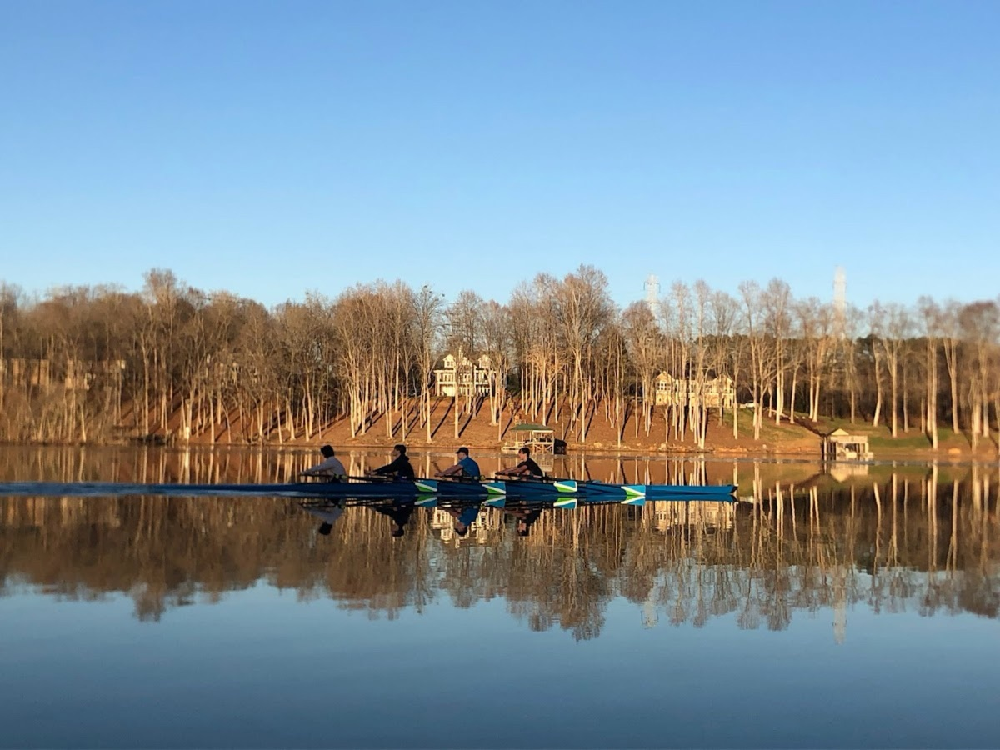

# Belmont Rowing Center website: notes for Claude

This is the website of **Belmont Rowing Center (BRC)**, a non-profit rowing club in
Belmont, NC. It is a [Quarto](https://quarto.org) website: pages are plain-text `.qmd`
(markdown) files, Quarto turns them into HTML in `docs/`, and GitHub Pages serves `docs/`.
It replaces the old WordPress site at https://www.belmontrowing.org/ and keeps the same
page addresses (`/about/`, `/youth/`, `/adult/`, `/other/`, `/contact/`).

The owner is **not a developer**. Keep changes small, explain them in plain words, and
never introduce frameworks or build tools. There is **one small script**,
`scripts/site.js`, which does only two things (see "The one script"); don't add more
JavaScript unless the owner asks.

**Seasonal information (practice schedules, regattas, camp / Learn To Row sessions, fees,
home-page Upcoming Events) lives in `schedule.xlsx`, not in the pages.** If the task is a
season update, read "Updating the schedule each season" below first.

## File map

| Path | What it is |
|---|---|
| `_quarto.yml` | Site settings: title, navbar links (incl. the green Register button), Social menu, footer contents, theme. |
| `theme.scss` | All shared styling and components. Design tokens (colours, fonts, sizes, spacing) are at the top; see "Design tokens". |
| `styles/_home.scss` … `_contact.scss` | Page-only styles, one small file per page, scoped with `.page-<name>`: only what one page can ever need (Adult and Contact need nothing). |
| `index.qmd` | Home page. |
| `schedule.xlsx` | **Everything that changes each season** (see "Updating the schedule each season"). |
| `R/schedule.R` | Reads `schedule.xlsx`, checks it, and builds the seasonal tables and facts for the pages. |
| `R/check-schedule.R` | `Rscript R/check-schedule.R`: checks the workbook and prints what is in it. |
| `about/index.qmd`, `youth/…`, `adult/…`, `other/…`, `contact/…` | Inner pages. |
| `404.qmd` | "Page not found" page. |
| `images/` | All photos. `images/staff/` holds coach and board portraits. |
| `_filters/main-landmark.lua` | Technical helper (adds an accessibility landmark). Don't edit. |
| `_filters/season-collapse.lua` | Folds completed season cards (see "Season card") and adds the `<script>` tag for `scripts/site.js` to every page. |
| `scripts/site.js` | The one small script (see "The one script"). Copied into `docs/` on render. |
| `images/share.jpg` | The picture shown when a page is shared (1200×630; set in `_quarto.yml`). |
| `docs/` | **Generated** website. Never edit by hand; it is rebuilt by `quarto render`. |
| `belmontrowing.Rproj` | Lets the folder open as a project in RStudio. |

## Render and preview

Rendering needs **R** (https://cran.r-project.org) with three packages, installed once:

```r
install.packages(c("knitr", "rmarkdown", "readxl"))
```

(`openxlsx` is only needed by Claude to edit the workbook from code: `install.packages("openxlsx")`.)

Quarto may not be on the PATH. Either install it (https://quarto.org/docs/get-started/)
or use the copy bundled with RStudio:

```bash
# from the project folder
/Applications/RStudio.app/Contents/Resources/app/quarto/bin/quarto render    # build docs/
/Applications/RStudio.app/Contents/Resources/app/quarto/bin/quarto preview   # live preview in a browser
```

(If `quarto` is on the PATH, just use `quarto render` / `quarto preview`.)
A render must finish with no errors before anything is committed.

## Deploying

1. `quarto render` (rebuilds `docs/`).
2. Commit **both** the changed source files and `docs/`, then push.
3. GitHub Pages (Settings → Pages → "Deploy from a branch", folder `/docs`) publishes it.

The repository is `belmontrowing/belmontrowing.github.io` on GitHub and the site is
published at https://www.belmontrowing.org (set as `site-url` in `_quarto.yml`).
The `CNAME` file in the project folder holds that address; it is listed under
`resources:` in `_quarto.yml` so every render copies it into `docs/`. Never delete it,
or the domain stops pointing at the site. `docs/.nojekyll` is created by Quarto; keep it.

The domain is registered at GoDaddy, which also holds its DNS records: `www` is a CNAME
to `belmontrowing.github.io`, the bare domain has four A records for GitHub Pages, and
the MX records send email to Google. Do not change the MX or TXT records.

## Rules

- **Words live in the `.qmd` pages; looks live in `theme.scss`.** Don't put colours,
  sizes, or `<style>` blocks in pages.
- Use the components below instead of raw HTML. If something new is needed, add a
  commented component to `theme.scss` (shared, the normal choice) or, only if it can
  never be wanted elsewhere, a rule in `styles/_<page>.scss` that starts with `.page-<name>`.
- **Paths:** in markdown always write images and internal links as
  `/images/photo.jpg` or `/adult/index.qmd#adultltr`. Quarto turns these into
  relative links that work from any folder. Never write `src="/..."` or
  `href="/..."` inside raw HTML, because the site may live in a sub-folder on GitHub Pages.
- Copy from the club is kept **word for word**, typos included. Fix them only when the owner asks.
- **Seasonal facts are never typed into pages again.** Dates, times, fees, season years and
  terms, regattas, sessions and prices come from `schedule.xlsx` through the functions in
  `R/schedule.R`. Change the workbook, not the `.qmd`.
- Keep anchor ids that other pages and the old site link to (see "Anchors" below).
- Always render before committing; commit `docs/` with the source change.
- No dark mode, no analytics, no JS frameworks; no JavaScript beyond `scripts/site.js`.

## Updating the schedule each season

**Read this first for any season update.** Everything that changes from season to season
is in one Excel workbook, `schedule.xlsx`, in the project folder. Pages never contain
those facts; they call small functions from `R/schedule.R`, which reads the workbook on
every render. Do not type seasonal dates, fees or tables into a `.qmd` again.

### The tabs

One row per thing, plain words in the cells (no markdown or HTML). Rows appear on the
website in the same order as in the tab. Fully blank rows are ignored.

| Tab | Columns | What it drives |
|---|---|---|
| `README` | — | Plain-English instructions for whoever opens the file. Not read by R. |
| `seasons` | `program`, `item`, `value`, `used on the website` | Single facts in sentences and headings: `year`, `term`, `start`, `end`, `fee`, `practice_days`, `groups`, `meets`, `regatta_season`, `months`, `register_link`. One row per fact; the last column (ignored by R) says where it appears. |
| `practices` | `program`, `day`, `time`, `activity`, `groups` | The Sunday–Saturday weekly tables (Youth, Youth Winter, Masters Winter, Masters Training, Masters Skills) **and** the small Season / Days / Times tables on the Adult page. `groups` is optional (Youth only; shown as a second row). |
| `regattas` | `program`, `date`, `regatta`, `location` | Youth and Masters regatta tables. |
| `sessions` | `program`, `dates`, `time`, `price`, `link` | Adult Learn To Row Date/Time table and session count; Youth Learn-To-Row and Development lines (these need `price`, and `link` while they are shown as links). |
| `prices` | `table`, `item`, `dates`, `price` | The three pricing tables on the Other page (`dates` only for `independent`). |
| `home_events` | `heading`, `link`, `line`, `bold`, `register` | "Upcoming Events" on the home page: one row per line; rows with the same `heading` form one block (same `link` on each), `bold` = `yes` makes a line bold, a `register` link (on one row of the block) adds a green Register button under it. |

Allowed names (the workbook has dropdowns with exactly these; `R/schedule.R` lists them in `.brc_tabs`):

- `seasons.program`: youth, youth-winter, masters-training, masters-skills, masters-winter, masters (regatta heading only), adult-learn-to-row, youth-summer, collegiate, independent
- `practices.program`: youth, youth-winter, masters-training, masters-skills, masters-winter; `practices.day`: Sunday … Saturday
- `regattas.program`: youth, masters
- `sessions.program`: adult-learn-to-row, youth-learn-to-row, youth-development
- `prices.table`: collegiate, private-lessons, independent

Things worth knowing:

- A line break inside a cell (Alt+Enter in Excel, `\n` from code) becomes a line break in
  the table cell, e.g. Youth Thursday's activity is `Strength Training` + new line + `(Coach Q)`.
- Several `practices` rows on the same day stack in that day's cell. The Days/Times
  summary groups days that share exactly the same `time` text (`Tue/Thu`), so type
  identical times identically.
- The season label in the summary table is `year` + `term` from `seasons` ("2026 Fall").
- Store text exactly as it should appear, typos included (e.g. "Aug 22th", "Augusto, GA").
- **Winter Training practice times** are whole sentences in `seasons` → `practice_days`
  for `youth-winter` and `masters-winter` (e.g. "Practices will be held weekday evenings at
  5:30PM … at 9:30AM."). The page keeps only "Welcome to the … team for {months} {year}."
  followed by `` `r season("youth-winter", "practice_days")` ``. Edit the times in the workbook.

### Functions and where they are used

Each page that uses them starts with a hidden setup chunk (`source("../R/schedule.R")`,
or `source("R/schedule.R")` on the home page). Chunk options (`echo`, `warning`,
`message` off, `output: asis`) are set once in `_quarto.yml` under `execute:`.

| Function | Gives | Used in |
|---|---|---|
| `` `r season(program, item)` `` | One fact, inline in a sentence or heading. `case = "upper"` / `"lower"` changes capitals. | youth (heading, season sentence, fee, regatta heading, camp heading, Winter welcome sentence incl. its practice times), adult (Masters Winter welcome sentence incl. its practice times, Masters headings, sentences, LTR heading and intro, LTR Register link, regattas heading), other (collegiate months, independent heading) |
| `` `r session_count(program)` `` | Number of sessions, e.g. "3" | adult (LTR intro sentence) |
| `weekly_table(program)` | Sunday–Saturday table | youth (`youth-winter`, `youth`), adult (`masters-winter`, `masters-training`, `masters-skills`) |
| `season_summary(program)` | Season / Days / Times table (narrow) | adult ×2 |
| `regatta_table(program)` | Date / Regatta / Location | youth (`youth`), adult (`masters`) |
| `session_table(program)` | Date / Time | adult (`adult-learn-to-row`) |
| `session_links(program, links = TRUE)` | Bold lines "dates, sessions run from time (price)", each linking to its sign-up; `links = FALSE` shows them as plain bold text (no `link` needed) | youth (`youth-learn-to-row`, `youth-development`; currently `links = FALSE` because the 2026 summer season is over; wrapped in `.date-list`) |
| `price_table(table)` | Pricing table (headers set in `.brc_price_tables` in `R/schedule.R`) | other ×3 |
| `home_events()` | The Upcoming Events blocks | home |

A table call is a one-line chunk:

````markdown
```{r}
weekly_table("masters-training")
```
````

### Check the workbook (no render needed)

```bash
Rscript R/check-schedule.R
```

It runs every check the render runs and prints the whole schedule, tab by tab, so you
can read the current season and confirm an edit. Exit status 1 plus a list of problems
(tab, row, what to fix) if anything is wrong. The render itself stops with the same
plain-English messages, e.g. an unknown program/day name, an empty required cell, a
date or time that Excel converted into a number ("Format this cell as Text and retype
it"), a missing tab or column, a duplicate `seasons` item, or a page asking for a fact
that is not in the workbook.

### How Claude edits the workbook

The workbook carries formatting a person relies on: bold frozen header row, column
widths, every data cell (rows 2–500) formatted as Text, dropdowns on the name columns,
header notes. **Never rebuild it from scratch or write it with `writexl` /
`write.xlsx()`** — that destroys all of this. Always **load → write cells → save** with
`openxlsx`, run from the project folder. Tested recipes:

```r
library(openxlsx)
path <- "schedule.xlsx"
wb <- loadWorkbook(path)

# Change a cell: the Masters Training fee (seasons tab).
s <- readxl::read_excel(path, sheet = "seasons", col_types = "text")
row <- which(s$program == "masters-training" & s$item == "fee") + 1   # +1: header is row 1
stopifnot(length(row) == 1)
writeData(wb, "seasons", x = "$600 or $125/month", startCol = match("value", names(s)), startRow = row)

# Add a row at the end of a tab (rows appear on the website in tab order).
r <- readxl::read_excel(path, sheet = "regattas", col_types = "text")
new <- data.frame(program = "masters", date = "December 5", regatta = "Head of the Lake",
                  location = "Lake Lanier, GA")
writeData(wb, "regattas", x = new[names(r)], startRow = nrow(r) + 2, colNames = FALSE)

saveWorkbook(wb, path, overwrite = TRUE)
```

```r
# Remove a row: clear its cells (Text format and dropdowns stay; blank rows are ignored).
library(openxlsx)
path <- "schedule.xlsx"
wb <- loadWorkbook(path)
r <- readxl::read_excel(path, sheet = "regattas", col_types = "text")
row <- which(r$regatta == "Head of the Lake") + 1
stopifnot(length(row) == 1)
deleteData(wb, "regattas", cols = seq_along(r), rows = row, gridExpand = TRUE)
saveWorkbook(wb, path, overwrite = TRUE)
```

- Always write **text** (`"2026"`, `"October 10"`), never numbers or `Date`s.
- To put a new row in the middle, or replace a whole season, read the tab, build the
  full new data frame in the order wanted, `writeData()` it from row 2 with
  `colNames = FALSE`, and `deleteData()` any leftover old rows below it.
- Write data only into rows 2–500 (the formatted, validated area).
- After editing: `Rscript R/check-schedule.R`, then render, then check the pages.
- Do not edit the file while the owner has it open in Excel (a `~$schedule.xlsx` lock
  file next to it means it is open); Excel would overwrite your change.

### Excel gotchas (tell the owner)

- **Keep cells formatted as Text.** All data cells already are. Pasting from elsewhere
  can bring a different format: use Paste Special → Values. If Excel turns "October 10",
  "10-11" or "7:30" into a date or number, the render stops and says which cell: format
  it as Text and retype it.
- **Save and close the workbook before rendering.** Only what is saved is read. The
  `~$schedule.xlsx` lock file Excel creates is git-ignored.
- Don't rename tabs or first-row column names; use the dropdowns for names.
- A new program (a brand-new team or table) needs a developer change: add its name to
  `.brc_tabs` in `R/schedule.R`, to the matching dropdown in the workbook (Data →
  Data Validation), and a call in the page.

## Design tokens

All in the `scss:defaults` part at the top of `theme.scss`. Change a token there, never a
colour or size inside a rule or a page. The look is called **"early water"**: deep navy,
crisp condensed headings, generous space, photos doing the emotional work.

| Token | Value | Used for |
|---|---|---|
| `$brc-navy-900` | `#0A1F3C` | footer, navy bands, photo overlays, open season-card heads |
| `$brc-navy-800` | `#10305A` | secondary dark (gradients on navy) |
| `$brc-blue` | `#045CB4` | brand blue (logo): links, small labels, focus rings |
| `$brc-blue-700` | `#034A91` | link hover |
| `$brc-blue-50` | `#EEF4FB` | callout and table-header tint |
| `$brc-sky` | `#9CC9F5` | links on navy |
| `$brc-green` | `#2A8436` | primary buttons (white text passes WCAG AA) |
| `$brc-green-700` | `#226E2C` | button hover |
| `$brc-green-accent` | `#7DBA3F` | logo green: thin rules and dots ONLY, never text, never behind text |
| `$brc-paper` | `#F6F7F4` | page background (`.band-light`) |
| `$brc-white` | `#FFFFFF` | cards, `.band-white` |
| `$brc-ink` / `$brc-text` / `$brc-muted` | `#14202E` / `#33414F` / `#5B6B7C` | headings / body text / secondary text |
| `$brc-hairline` | `rgba(10,31,60,.12)` | borders and dividers |

- **Fonts** (Google Fonts, `display=swap`, only these weights): **Barlow Condensed** 600/700
  for headings, buttons and labels (uppercase, slightly tracked: boat lettering / regatta
  signage); **Inter** 400/500/600 (+400 italic) for everything else, 17px body, line-height 1.65.
- **Type sizes**: `$brc-size-hero` (home headline), `$brc-size-page` (inner page title),
  `$brc-size-h2`, `$brc-size-h3`, `$brc-size-card` (titles inside cards), `$brc-size-lead`
  (1.125–1.25rem), `$brc-size-eyebrow`: all fluid `clamp()`s.
- **Space**: 8px scale (`.5rem 1rem 1.5rem 2rem 3rem 4rem 6rem`); bands use
  `$brc-section-pad` (`clamp(3.5rem, 8vw, 7rem)`) top and bottom; content width
  `$brc-container` 1180px with `$brc-gutter` side margins; running text stops at
  `$brc-measure` (68ch); cards use `$brc-card-pad` inside.
- **Shape**: `$brc-radius` 12px (cards, photos, tables), `$brc-radius-sm` 8px (buttons);
  one shadow `$brc-shadow` (+ `$brc-shadow-lift` on hover); hairline borders; `$brc-rule`
  is the blue-to-green rule across the top of titled cards.
- **Motion**: every hover, colour and photo-zoom transition is `$brc-ease` (.18s); all of it
  is switched off for visitors who ask for reduced motion.
- **Focus**: every link, button and the embedded map shows a solid 3px ring: brand blue on
  light surfaces, white on dark ones (hero, navy bands, open season-card heads, the CTA card,
  the footer). Mixin `brc-focus-ring`.
- **Tap targets**: buttons, sub-nav links, footer links, card links, emails and menu items
  are at least 44px tall. Links inside sentences are exempt.
- **Header/sub-nav heights**: `$brc-header-h` 76px (64px below 992px), `$brc-subnav-h` 52px.
  `html { scroll-padding-top }` adds both so jump links land below the sticky bars.

**Three kinds of box, no more.** Use these and nothing else:

| Kind | Look | Components |
|---|---|---|
| **Card** | white, hairline, one soft shadow; paper with no shadow on a white band; titled cards get the blue-to-green top rule and an uppercase condensed title; bullets are green dots | `.tile` (+ value cards), `.person`, `.price-card`, `.event`, the About letter |
| **Callout** | pale blue with an info mark | `.info-box` |
| **Feature** | navy head | `.season-card` (and the Contact page's `.cta-card`) |

Lighter elements that are not boxes: `.note` (green rule at the left), `.fine-print`,
`.table-note`, `.status-note`, `.checklist`, `.doc-list`, `.date-list`, `.faq`.

## Standard inner page (copy this to start a new page)

Every inner page has the same shape: **page header (photo with the `#` title over it) →
sub-navigation (jump links) → one band per section, alternating paper and white.** Every
section heading is STACKED: the `##`, its short green rule, then the content. (The
side-by-side "split" layout is only for the home page's editorial sections.)

```markdown
---
title: "Adult Rowing Charlotte NC"
description: "One-sentence summary for search engines."
body-classes: page-adult
---

<!-- PAGE HEADER: photo with the page title over it -->
::: {.hero .hero-short}
{.bg alt="" style="object-position: center 30%"}

# Adult Rowing Charlotte, NC

[Belmont Rowing Center - Adult Programs]{.subheading}
:::

<!-- SUB-NAVIGATION: jump links to the sections below -->
::: {.pill-nav role="navigation" aria-label="On this page"}
[MASTERS TRAINING](#masters) [LEARN TO ROW](#adultltr)
:::

<!-- MASTERS TRAINING TEAM -->
::: {.band .band-light}
## MASTERS TRAINING TEAM {#masters}

Section text, notes, season cards, tables, tiles…

### A sub-head

More text…
:::

<!-- ADULT LEARN TO ROW -->
::: {.band .band-white}
## ADULT LEARN TO ROW {#adultltr}

Section text…
:::
```

- `title:` sets the browser-tab title; Quarto's automatic title is hidden, so the
  page shows its own `#` heading (exactly one per page), inside the page header.
- `body-classes: page-<name>` lets `styles/_<name>.scss` target this page only. Those
  files hold only what one page can ever need (About: the letter; Youth: the spacing of the
  Financial Aid callout; Other: the price-card-beside-text layout and the
  ROAR logo; Home: the intro). Anything two pages need goes in `theme.scss`.
- Each section is ONE band that starts with its `##`; the `{#id}` is what the sub-nav
  links jump to. Use `###` / `####` inside. Alternate `.band-light` and `.band-white`.
- The subtitle and sub-navigation are optional (Other has no subtitle; Contact has neither).
- **Lead paragraph** (`::: {.lead}`): only the FIRST paragraph of a section, and only when
  it is 4 lines or fewer on a laptop. Everything else is body size. Don't bold whole
  paragraphs.
- Buttons: `.btn-brc-lg` only in heroes and CTA bands; everywhere else the normal size.

## Component reference

All components are Quarto "fenced divs" (`::: {.class}` … `:::`) or link/span classes.
When divs are nested, give the outer one more colons (`::::`) so it's easy to read.
Every snippet below has been rendered and checked at 1440px and 390px.

**Pandoc gotcha (every page hits it):** a fenced div that **starts with a heading** becomes
that heading's `<section>`, carrying the div's classes. `::: {.season-head}` + `### …`
turns into `<section class="season-head">`. So in SCSS style `section.x` or `.x`, never
`.x > section`, and a class on a heading (`## X {.big}`) is copied onto its section: style
`h2.big`, never `.big` alone.

### Page header (photo + navy gradient + title)

The **first line inside must be the photo with `{.bg alt=""}`**; the theme stretches it
to fill the header. `alt=""` marks it as decorative.

```markdown
::: {.hero .hero-short}
{.bg alt="" style="object-position: center 10%"}

# Youth Rowing Charlotte, NC

[Belmont Rowing Center - Youth Programs]{.subheading}
:::
```

About 500px tall on a laptop, 300px on a phone. `object-position` chooses which part of the
photo stays in view (`center 0%` = top, `center 100%` = bottom); aim group photos at the
faces (Youth `center 10%`, Adult `center 30%`).

**Home page hero** (tall; eyebrow line, headline, sub-line, buttons):

```markdown
::: {.hero}
{.bg alt=""}

[LOCATED ON THE CALM WATERS OF THE CATAWBA RIVER, JUST 10 MILES WEST OF UPTOWN CHARLOTTE]{.tagline}

# Row Together, Grow Together

Your Seat Is Waiting!

::: {.btn-row}
[Register Today!](https://www.icrew.club/register?clubkey=1626fb75-9eb1-b24b-4202-b008f5af5980){.btn-brc .btn-brc-lg} [About Us](/about/index.qmd){.btn-brc-outline .btn-brc-lg}
:::
:::
```

The club's photo is only 1200px wide, so the theme caps the hero at 720px tall, darkens it a
little, and zooms/positions the crop per screen size so the headline never sits on the
rowers (`.hero:not(.hero-short)` in `theme.scss`, section 5). On phones the photo sits above
the words. A replacement home photo should be at least 1920px wide; recheck the crop at
1920, 1440, 1024, 768 and 390.

### Sub-navigation (in-page jump links)

The class is still called `.pill-nav`. Directly after the page header (NOT inside a band),
all links on **one line**, separated by spaces; targets are heading ids. The `role` and
`aria-label` make it a named navigation landmark for screen readers.

```markdown
::: {.pill-nav role="navigation" aria-label="On this page"}
[COACHES](#coaches) [BOARD MEMBERS](#boardmembers) [HISTORY](#history1)
:::
```

A white bar that sticks under the header on computers; on phones it scrolls sideways with a
fade at the right edge. As the visitor scrolls, `scripts/site.js` marks the link of the
section in view (`aria-current="true"`, the same green underline as hover) and keeps it in
view in the sideways bar. Without JavaScript the bar simply has no marker.

### Section bands and section headings

```markdown
::: {.band .band-light}
## MASTERS TRAINING TEAM {#masters}

Text…
:::
```

`.band-light` (paper), `.band-white`, `.band-navy` (only for the Donate band). Every `##` in
a band is left-aligned, uppercase, with a short light-green rule under it. Sub-heads
(`###`) sit stacked above their content.

### Donate band (call to action: Home and About)

Full-bleed navy band, centred: `##` headline, optional `###` line, text, a large button.
On a page with this band, the footer's "Donate To Support Our Growth" becomes a plain link.

```markdown
::: {.band .band-navy .band-cta}
## DONATE {#donate}

### Support Our Growth

Belmont Rowing Center is registered as a [501(c)(3)]{.nowrap} non-profit organization. …

::: {.btn-row}
[Donate Today](https://www.zeffy.com/en-US/donation-form/support-the-growing-sport-of-rowing-at-belmont-rowing-center){.btn-brc .btn-brc-lg}
:::
:::
```

(Home wraps the same content in `::: {.centered}` and has no `###`.)

### CTA card (Contact page "Contact Us")

An inset navy card on a light band (so it doesn't run into the navy footer): heading and
line on the left, button on the right; stacked and centred on phones.

```markdown
::: {.band .band-light}
:::: {.cta-card}
## Contact Us

Email us at [info@belmontrowing.org](mailto:info@belmontrowing.org)

::: {.btn-row}
[Email Us](mailto:info@belmontrowing.org){.btn-brc .btn-brc-lg}
:::
::::
:::
```

### Buttons

```markdown
[Register](https://www.icrew.club/register?clubkey=1626fb75-9eb1-b24b-4202-b008f5af5980){.btn-brc}
[More details](/adult/index.qmd#adultltr){.btn-brc-outline}
```

`.btn-brc` = green (the main action), `.btn-brc-outline` = outline (blue on light, white on
photos and navy), `.btn-brc-lg` = bigger, ONLY in heroes and CTA bands. Labels are set in
uppercase condensed type by the theme; type them as the club wrote them. A row of buttons:

```markdown
::: {.btn-row}
[Register Today!](https://www.icrew.club/register?clubkey=1626fb75-9eb1-b24b-4202-b008f5af5980){.btn-brc}
:::
```

The header's own green **Register** button is the last `navbar:` item in `_quarto.yml`;
`theme.scss` (section 2) recognises it by its `icrew.club/register` address.

### Season card (a programme's season, with Register or a "completed" status)

The standard block for every season on the Youth and Adult pages: navy head with the season heading
and the Register button at the right, then the season sentence, then the tables. Facts come
from `schedule.xlsx` as usual.

````markdown
:::: {.season-card}
::: {.season-head}
### `r season("youth-winter", "year")` Youth Team - `r season("youth-winter", "term")`

::: {.btn-row}
[Register](`r season("youth-winter", "register_link")`){.btn-brc}
:::
:::

Welcome to the Youth Winter Training team for …

```{r}
weekly_table("youth-winter")
```

::: {.table-note}
On race weeks, Friday’s practice is moved to Thursdays
:::
::::
````

- A `season_summary()` table sits beside the text on computers (under it on phones, and always under it once a season is folded); a
  `weekly_table()` fills the bottom of the card; a `session_table()` sits inset; a
  `::: {.table-note}` closes the card.
- If the club's text puts the Register button AFTER the sentence and table, leave it there
  as a `::: {.btn-row}` at the end of the card: the theme shows it in the head (the reading
  order stays the club's).
- **Completed season**: put a status note in the head where the button was. That's all.
  The filter `_filters/season-collapse.lua` then **folds the card up**: the heading stays
  visible (a real heading), the status note becomes a full-width bar with a round chevron,
  and the sentence and tables sit behind it (a native `<details>`/`<summary>`: click, tap,
  Enter or Space opens it; no JavaScript). Open, the card is quiet (paper head, no shadow,
  body and tables one step muted). Every word and table stays in the page. Printing shows
  the content open (in browsers that support it). Open seasons (a Register button in the
  head) never fold.
- A completed season with no heading of its own (Youth Summer Programs, whose title is the
  section heading) uses a head that holds only the status note; everything after it in
  the card folds:

````markdown
:::::: {.season-card}
::: {.season-head}
::: {.status-note}
The season has completed. Please stay tuned for 2027 scheduling.
:::
:::

Rowing is a great team-oriented sport …

### `r season("youth-summer", "year")` Summer Camp Offerings

…camp tiles…
::::::
````

````markdown
:::: {.season-card}
::: {.season-head}
### `r season("youth", "year")` Youth Team - `r season("youth", "term")` Season

::: {.status-note}
The season has completed. Please stay tuned for 2027 scheduling.
:::
:::

The `r season("youth", "year")` Youth `r season("youth", "term")` Season starts on …

```{r}
weekly_table("youth")
```
::::
````

### Status note

A short italic status line with a check mark: in a season-card head (above) it replaces the
Register button and becomes the bar that opens the folded card; on its own (outside a
season card) it is a small bordered line.

```markdown
::: {.status-note}
The season has completed. Please stay tuned for 2027 scheduling.
:::
```

#### Marking a season complete, and opening a new one

1. **Season over**: in the page, replace that season card's `::: {.btn-row}` [Register] block
   with the `::: {.status-note}` block above (keep the heading, sentence and tables). The
   card folds up on the next render. For the
   Youth summer camps, also switch `session_links(...)` to `links = FALSE` so the dates show as
   plain text (no sign-up links needed in the workbook).
2. **New season** (e.g. Winter Training): add its facts and practices to `schedule.xlsx`
   (a programme name from the allowed list, e.g. `youth-winter`, `masters-winter`; its
   `register_link` in `seasons`), then add an open season card ABOVE the completed one,
   using `season("<program>", ...)` for the heading, `[Register](`r season("<program>", "register_link")`)`
   for the button and `weekly_table("<program>")` for the grid.
3. **Reopen a folded season** (same programme, new dates): update its facts in the
   workbook and put the `::: {.btn-row}` [Register] block back in its head in place of the
   status note. It unfolds and turns navy again.
4. A brand-new programme name needs a developer change in `R/schedule.R` (see "Excel gotchas").

### Tables (schedules, regattas, sessions, prices)

**Seasonal tables are generated** from `schedule.xlsx` by one-line R chunks; the functions
write a markdown table inside `::: {.schedule}`, and the theme does the rest. Hand-write a
table like this only for something that is not seasonal:

```markdown
::: {.schedule}
| Season  | Fall        |
|---------|-------------|
| Tue/Thu | 6:00p-8:00p |
:::
```

- White rounded box, pale-blue header row of small capitals, hairlines, light zebra rows.
  `::: {.schedule .schedule-narrow}` is the small Season / Days / Times summary.
- 3-column tables (regattas): the name in the middle is bold, the date regular. Put the
  "Above schedule are potential regattas …" caption UNDER the table as `::: {.table-note}`.
- **Weekly tables** (5+ columns, Sunday–Saturday): equal columns with a hairline between
  days; empty days are a flat paper tint; a second row (Youth age groups) is smaller and muted.
- Use `<br>` for a second line inside a cell. **Column-width gotcha:** Pandoc sizes columns
  from the dashes in the `|-----|` row when a line is long; the theme ignores those widths
  (`.schedule col`), so don't line the dashes up and don't remove that rule.

**Tables on phones** (shared by every page; nothing scrolls sideways):

| Table | Below 768px / 576px it becomes |
|---|---|
| weekly grid | a list of practice days: day name in blue at the left, time and activity beside it; empty days hidden; the second row (age groups) as a third line under its day |
| 3 columns (regattas) | stacked rows: small blue date, bold regatta, muted location |
| 2 columns (Learn To Row sessions) | stacked rows: bold dates, muted times |
| summary (`.schedule-narrow`) | the season on top, Days and Times side by side |
| price tables in a `.price-card` | stay tables; 3 columns become name + dates on the left, price at the right |

The real header row stays in the page for screen readers (visually hidden). **Coupling:**
the day names on phones are written by CSS (`$brc-days` in `theme.scss`, section 12) and
rely on `weekly_table()` always writing the columns **Sunday → Saturday** in that order
(`.brc_days` in `R/schedule.R`). If that order ever changes, change `$brc-days` too.

### Price card (Other page pricing)

````markdown
::: {.price-card}
### BRC Private Lesson Pricing

```{r}
price_table("private-lessons")
```

::: {.price-note}
Pricing is for 1 rower in a sculling boat. Please contact us for multi-rower options.
:::
:::
````

A Card with the top rule; the R table loses its own box and the prices are set large. A
`.price-note` placed FIRST in the card becomes a pale-blue line with a calendar mark (the
Collegiate "Rates are set on a pro-rata basis…" line). It fills its column (full width when
on its own, as for Independent Rowing). On phones the item names wrap, the price stays on
one line at the right, and the dates line is regular and muted.

### Location: address cards and a map (Home, About, Contact)

```markdown
:::: {.location}
::: {.address-card}
**Physical Location:**

1500 River Drive\
Belmont, NC 28012

[Get Directions](https://www.google.com/maps/dir//35.2373424,-81.0156972/@35.2366652,-81.0164385,17.49z/data=!4m2!4m1!3e0){.btn-brc-outline}
:::

::: {.address-card .address-mailing}
**Mailing Address:**

Belmont Rowing Center\
PO Box 1401\
Belmont, NC 28012
:::

::: {.location-map .framed}
{fig-alt="Map showing the location of Belmont Rowing Center at 1500 River Drive, Belmont, NC, on the Catawba River" width="726" height="490" loading="lazy"}
:::
::::
```

Cards stacked on the left, map on the right; on phones the cards come first, then the map.
In a card, a first line that is only **bold** becomes the small blue label; a third line
(About's "We launch and have parking…") is muted; a button sits at the bottom.
`.address-mailing` swaps the pin for a mailbox. The map can also be the embedded Google map:

```markdown
::: {.location-map .map-embed}
<iframe loading="lazy" src="https://maps.google.com/maps?q=1500%20river%20drive%20Belmont%2C%20nc%2028012&amp;t=m&amp;z=12&amp;output=embed&amp;iwloc=near" title="1500 river drive Belmont, nc 28012"></iframe>
:::
```

(Raw HTML is allowed only for this map and a future form. Keep the iframe's `title`.)

### Callout, notes, lead

```markdown
::: {.info-box}
### Financial Aid Available

We offer financial aid for programs based on need. …
:::

::: {.note}
**New rowers at this level are welcome to join the team at any point during the season!**
:::

::: {.fine-print}
BRC uses the iCrew team management platform to manage registrations, …
:::

::: {.lead}
For college rowers that are living in Charlotte for the summer …
:::
```

`.info-box` = pale-blue Callout. `.note` = a line that must stand out (green rule at the
left; a second paragraph is small and muted). `.fine-print` = small muted text under a
hairline. `.lead` = first paragraph of a section only, 4 lines or fewer on a laptop.

### Lists: checklist, document links, dates, FAQ

````markdown
::: {.checklist}
- General Water Safety
- Rowing Safety
:::

::: {.doc-list}
**[BRC Safety Policy](https://drive.google.com/file/d/1D4yfsQwteLG-jOoWZRWqejBiDfsj7Gzk/view?usp=share_link)**

**[BRC Weather Policy](https://drive.google.com/file/d/1eCwa2g2AicR4t2Oy4iSEPZmJbJrAMTwS/view?usp=share_link)**
:::

::: {.date-list}
```{r}
session_links("youth-learn-to-row", links = FALSE)
```
:::

::: {.faq}
**Do I need prior rowing experience?:** No experience is required, we welcome people of all athletic abilities!

**Is there a cost for the program?:** Programming will be provided free of charge …
:::
````

- `.checklist`: green check marks, two columns on wide screens (`.checklist-1col` for one).
- `.doc-list`: each link a full-width row with a file icon (a markdown list works too).
- `.date-list`: plain lines of dates and prices with a calendar mark (not clickable). If the
  camps open again and `session_links()` goes back to `links = TRUE`, use `.doc-list` instead
  so the lines read as links.
- `.faq`: each paragraph is `**Question?:** answer`; the question goes on its own line.

### Cards: tiles and value cards

```markdown
:::: {.tile-grid}
::: {.tile}
#### Required Gear

- Athletic clothing
  - Close-fitting
- Socks
:::

::: {.tile}
#### Recommended Gear

- Hat
:::
::::
```

A tile is the Card: top rule, uppercase condensed title (`###` or `####`), green-dot bullets
(nested items as small muted dashes). Tiles share the row (wrap at 260px). Youth's camp
cards, the Adult page's Sculling/Sweep and gear, About's programme lists and Other's Equipment Use /
Regattas are all tiles. **Value cards** (home "Our Values"): `:::: {.tile-grid .tile-grid-featured}`:
three per row, a shorter last row centred (5 = 3 + 2).

### People (coaches, board)

One wide card (portrait 4:5 left, text right):

```markdown
::: {.person}
{.person-photo loading="lazy" alt="Johanna Niederbroker"}

::: {.person-body}
### Johanna Niederbroker
[BRC Head Coach]{.role} [she/her]{.pronouns}

Johanna brings 20 years of competitive rowing experience …

[Coach.Johanna@belmontrowing.org](mailto:Coach.Johanna@belmontrowing.org){.email}
:::
:::
```

Several people: wrap their `.person` cards in `:::: {.people-grid}` … `::::` for **compact
cards** two per row (small portrait beside name/role/pronouns, the bio below, the email at
the bottom above a hairline; one per row on phones). Every `.person` becomes compact on
phones. Portraits are cropped 4:5 from the top: for an action photo, make a tight crop first
(e.g. `images/staff/kristin-sherman-portrait.jpg`). No photo: `::: {.person .no-photo}`.

**Name and role only**: compact cards without the top rule.

```markdown
:::: {.tile-grid}
::: {.tile .person-tile}
### Clair Kettle
[Secretary]{.role}
:::
::::
```

### Home page components

- **Photo card grid**: 4 across, 2×2 on tablets and phones; the whole card is the link.

```markdown
:::: {.card-grid}
::: {.photo-card}
{.bg alt="" style="object-position: top"}

[Youth Programs](/youth/index.qmd)
:::
::::
```

- **Upcoming events**: `home_events()` writes `:::: {.events}` with one `::: {.event}` Card
  per heading (heading link with arrow, lines, Register button); 2–3 across from tablets up.
  Put the `## Upcoming Events` heading stacked above the chunk.
- **Split** (home only: "Our Club", "Our Core Activities"): heading left (4), content right (8).

```markdown
:::: {.two-col .split}
::: {}
## Our Club
:::

::: {}
Content…
:::
::::
```

- `:::: {.two-col}` (two equal columns, stacked below 768px) is used for the home intro and
  the ROAR introduction beside its logo; `::: {.framed}` frames an inline image.

### Text helpers

```markdown
::: {.centered}
Short centred block: a heading + a button. Not for paragraphs.
:::

## Belmont Rowing Center {.display-heading}

[Charlotte Rowing At It's Best]{.motto}

[Belmont Rowing Center - Youth Programs]{.subheading}

[501(c)(3)]{.nowrap}
```

`.nowrap` keeps a short token on one line (it adds a span, not words). `.tagline` is the
home hero's eyebrow line. `.text-center` and `.small` come from Bootstrap.

### Header and footer

- **Header**: white, slim, always visible: logo left, menu right, one green **Register**
  button last. The menu is the `right:` list under `navbar:` in `_quarto.yml`, shown in
  that order: **Home, About Us, Programs ▾ (Youth, Adult, Other), BRC Swag, Contact,
  Social ▾ (Instagram, Facebook, YouTube, Concept 2), Donate, Register**.
  - To add, rename or reorder an item, edit or move its `- text: … / href: …` entry. Our own
    pages: `href: youth/index.qmd` (no leading slash; Quarto fixes the path for every
    folder). Outside sites: add `target: _blank` and `rel: noopener`.
  - A dropdown is an entry with `text:` and a `menu:` list of items (Programs and Social).
    Social items also carry `icon:` (a Bootstrap Icons name).
  - Navigation labels for the adult page say **Adult** (parallel with Youth), here and in
    the footer. Page content ("Adult Rowing Charlotte, NC", "Adult Programs") is unchanged.
  - **Donate** (outlined, quieter) and **Register** (green, the main action) are the last two
    entries, in that order. `theme.scss` styles them as buttons by their addresses
    (`zeffy.com` and `icrew.club/register`); both open in a new tab. From 992 to 1199px the
    menu spacing tightens so everything stays on one line.
  - Current page: Quarto marks a top-level link `.active` (green underline). It does not
    mark a dropdown's parent, so `theme.scss` (section 2, "Programs dropdown") does it:
    on pages whose body class is `page-youth`, `page-adult` or `page-other`, the Programs
    item gets the underline and that page's row in the panel is highlighted; a `:has()`
    rule also underlines any dropdown that contains a `.dropdown-item.active`. A NEW
    programme page under Programs needs its body class added to those two selectors.
  - Below 992px the menu folds into a button at the right; dropdowns open in place with
    their items indented under them (48px rows) and Register at the bottom.
- **Sharing preview**: `image: images/share.jpg` and `image-alt:` under `website:` in
  `_quarto.yml` (with `open-graph: true` and `twitter-card: true`) give every page the
  same preview picture, as an absolute `https://www.belmontrowing.org/...` address. A page
  can use its own picture with `image: /images/x.jpg` in its front matter (1200×630 is best).
- **Footer**: navy, written in `_quarto.yml` under `page-footer:` as three markdown slots:
  `left` (club name `{.footer-brand}`, motto `{.footer-motto}`, the 501(c)(3) line, the Donate
  link `{.footer-donate}`), `center` (two `::: {.footer-col}` blocks: Visit = addresses +
  email, Explore = Home, About Us, Youth, Adult, Other, Contact, BRC Swag) and `right` (Follow = social links). Column labels are
  `[Visit]{.footer-label}`. Write our own pages as `/about/index.qmd` (Quarto makes them
  work from every folder, including the 404 page) and give outside links
  `{target="_blank" rel="noopener"}`. Icons are Bootstrap Icons spans:
  `[]{.bi .bi-instagram aria-hidden="true"}`. Icons the theme adds itself use
  `content: "\F138" / ""` (mixin `brc-icon`) so they never become part of a link's name.

## The one script (`scripts/site.js`)

Plain JavaScript, about 50 commented lines, no libraries. `_filters/season-collapse.lua`
adds `<script src="…/scripts/site.js" defer>` to every page with the right relative path,
and `resources:` in `_quarto.yml` copies `scripts/` into `docs/`. It does exactly two things:

1. **Current section in the jump-link bar**: as the page scrolls it checks the sections the
   bar links to (the current one is the last whose top has passed a line a little above
   the middle of the window; at the very bottom of the page, the last section) and sets
   `aria-current="true"` on the link of the section in view; on phones it also scrolls the
   bar sideways to keep that link visible (never the page). Pages without a bar: nothing.
2. **Space opens the header dropdowns** (Programs, Social), like Enter.

Everything works without it. Don't add features to it, or new scripts, unless the owner asks.

## Contact form (none at the moment)

The site has **no contact form**. The Contact page's "Contact Us" section is the navy
`.cta-card`: one line linking to info@belmontrowing.org plus a green "Email Us" button,
both plain `mailto:` links (ordinary markdown, no raw HTML).

The form styling is kept in `theme.scss` (section 19, `.site-form`) in case a form is
wanted later. A form needs a form service so messages arrive without the visitor's own
email app: **Web3Forms** (web3forms.com; get an access key for info@belmontrowing.org,
which is meant to be public) or **Formspree** (formspree.io; create a form and use its
endpoint as `action="https://formspree.io/f/YOUR_FORM_ID"` and drop the `access_key` line).
Put this raw HTML block inside the Contact page's content band, render, and send a test
message:

````markdown
```{=html}
<form class="site-form" action="https://api.web3forms.com/submit" method="post">
<input type="hidden" name="access_key" value="YOUR_ACCESS_KEY">
<div class="form-field">
<label for="contact-name">Name <span class="form-required" aria-hidden="true">*</span></label>
<input type="text" id="contact-name" name="name" autocomplete="name" required>
</div>
<div class="form-field">
<label for="contact-email">Email <span class="form-required" aria-hidden="true">*</span></label>
<input type="email" id="contact-email" name="email" autocomplete="email" spellcheck="false" required>
</div>
<div class="form-field">
<label for="contact-message">Message <span class="form-required" aria-hidden="true">*</span></label>
<textarea id="contact-message" name="message" rows="6" required></textarea>
</div>
<div class="form-actions">
<button type="submit" class="btn-brc">Submit</button>
</div>
</form>
```
````

- The `name="…"` attributes become the labels in the email you receive; `email` also
  lets you press Reply.
- Other helpers in `theme.scss`: `.form-row` (side-by-side fields), `.form-sublabel`,
  `.form-check` (checkbox + label), `fieldset.form-field` with a `<legend>` for groups.
- Do not use `action="mailto:…"`: it only works for visitors with an email app set up.

## Where to change common things

| Task | Where |
|---|---|
| Upcoming events on the home page | `schedule.xlsx`, tab `home_events` |
| Season dates, fees, practice times, regattas, sessions, prices | `schedule.xlsx` (see "Updating the schedule each season") |
| How a seasonal table looks / is built | `R/schedule.R` (styling: `.schedule` in `theme.scss`, section 12, incl. the phone layouts) |
| Mark a season complete / open a new one | the season card in `youth/index.qmd` or `adult/index.qmd` (see "Season card") + `schedule.xlsx` |
| Coach / board bios and photos | `about/index.qmd` (`.person` cards in `.people-grid`, `.person-tile`s) + `images/staff/` |
| Navbar, Register button, Social menu, footer | `_quarto.yml` (`navbar:` and `page-footer:`; see "Header and footer"). Navbar links to other websites carry `target: _blank` and `rel: noopener` so they open in a new tab; copy those two lines onto any new outside link. In the footer's markdown, outside links end with `{target="_blank" rel="noopener"}` (the Donate line uses `{.footer-donate target="_blank" rel="noopener"}`). Our own pages leave them out. |
| Registration link (iCrew) | Search all `.qmd` files and `_quarto.yml` (header button) for `icrew.club` |
| Donate link (Zeffy) | Search for `zeffy.com` (home, about, and the header button and footer in `_quarto.yml`) |
| Sharing preview picture | `images/share.jpg` + `image:` / `image-alt:` in `_quarto.yml` |
| Winter practice times | `schedule.xlsx`, `seasons` → `practice_days` for `youth-winter` / `masters-winter` |
| Address / mailing address | `contact/index.qmd`, `about/index.qmd` (Location), `index.qmd` (Find Us) and the footer in `_quarto.yml` |
| Contact email address | `contact/index.qmd`, the "Contact Us" section (see "Contact form") |
| Colours, fonts, sizes, spacing | Design tokens at the top of `theme.scss` (see "Design tokens") |
| Logo / favicon | `images/logo.jpg`, `images/favicon.png` (set in `_quarto.yml`) |

### Images

- Put photos in `images/` (portraits in `images/staff/`), lowercase-hyphenated names,
  e.g. `images/staff/jane-doe.jpg`.
- Page-header and home-hero photos should be at least 1600px wide (they fill the window).
- Resize before adding (macOS): `sips -Z 2000 photo.jpg` (hero/banner),
  `-Z 1200` (cards, inline photos), `-Z 800` (portraits). Use JPEG for photos,
  aim for under ~500 KB each. `sips -Z` only shrinks if you choose a size smaller than
  the photo; check the size first with `sips -g pixelWidth -g pixelHeight photo.jpg`.
- Every meaningful image needs alt text (`alt="…"` or `fig-alt="…"`); decorative
  background photos use `alt=""`.

### Anchors other pages link to (keep these ids)

- about: `coaches`, `boardmembers`, `history1`, `policies`, `location`, `donate`
- youth: `youth`, `youthLTR` (home page links here)
- adult: `masters`, `devo`, `adultltr` (home page links here), `masterregattas`
- other: `collegiate`, `roar`, `private`, `independent` (adult page links to `#independent`)

Ids are case-sensitive: `#adultltr` and `#adultLTR` are different.
