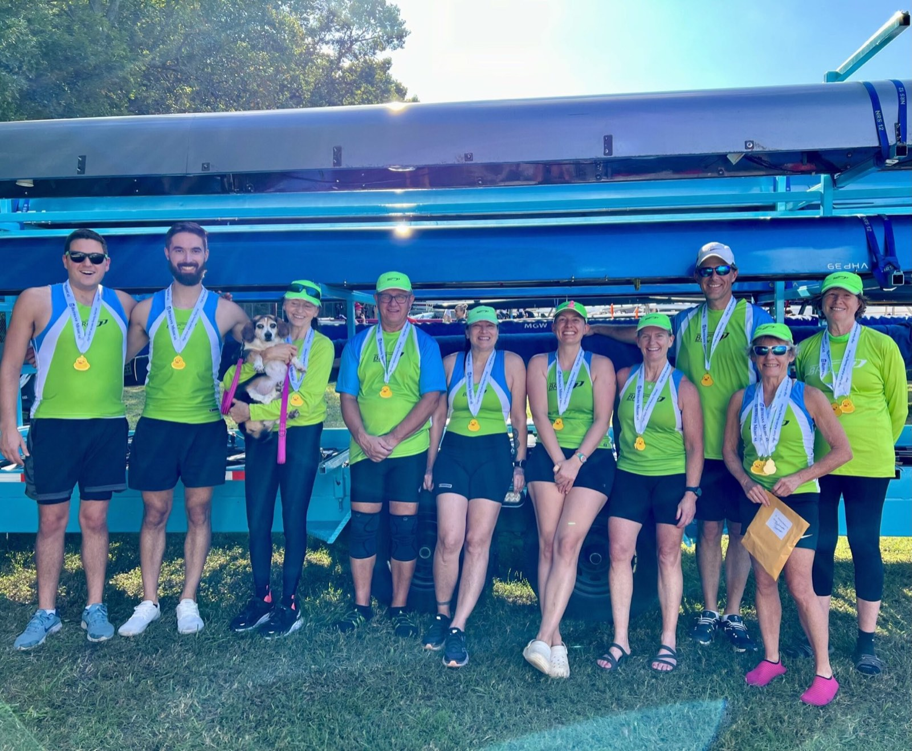
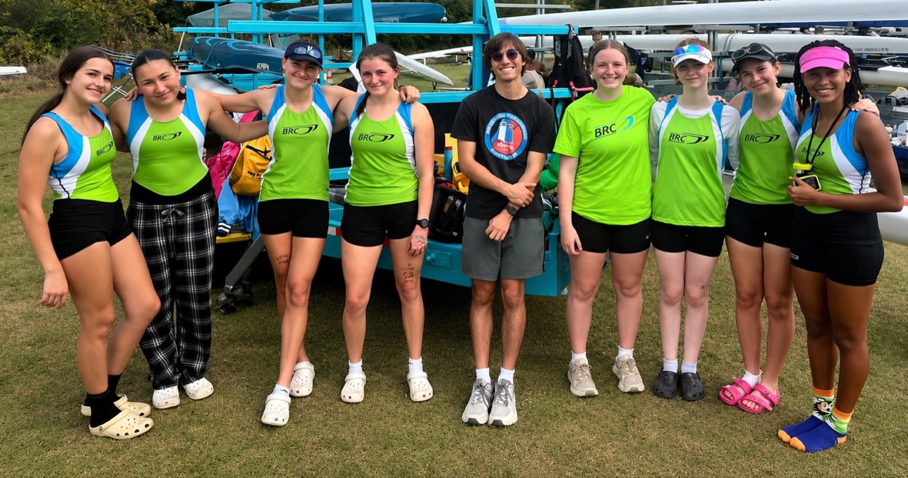
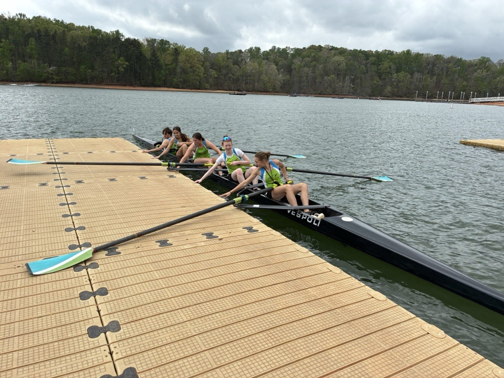
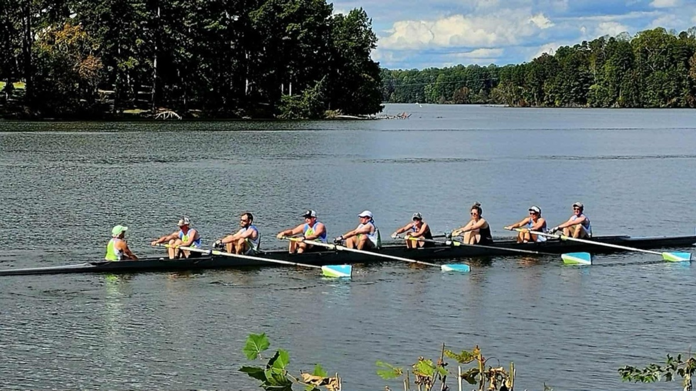
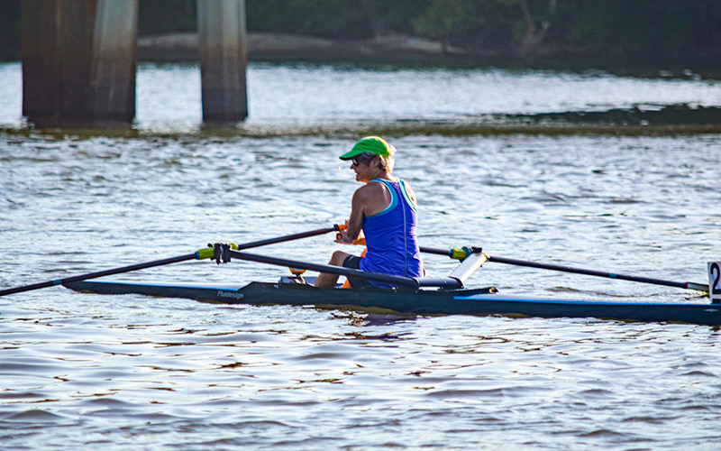
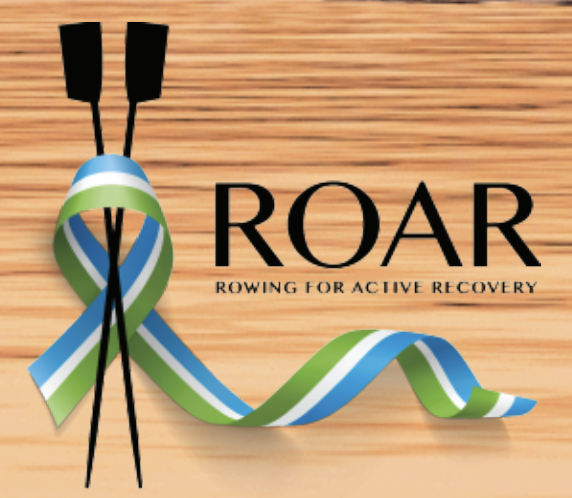

# Belmont Rowing Center website: notes for Claude

This is the website of **Belmont Rowing Center (BRC)**, a non-profit rowing club in
Belmont, NC. It is a [Quarto](https://quarto.org) website: pages are plain-text `.qmd`
(markdown) files, Quarto turns them into HTML in `docs/`, and GitHub Pages serves `docs/`.
It replaces the old WordPress site at https://www.belmontrowing.org/ and keeps the same
page addresses (`/about/`, `/youth/`, `/adult/`, `/other/`, `/contact/`).

The owner is **not a developer**. Keep changes small, explain them in plain words, and
never introduce frameworks, build tools, or custom JavaScript.

**Seasonal information (practice schedules, regattas, camp / Learn To Row sessions, fees,
home-page Upcoming Events) lives in `schedule.xlsx`, not in the pages.** If the task is a
season update, read "Updating the schedule each season" below first.

## File map

| Path | What it is |
|---|---|
| `_quarto.yml` | Site settings: title, navbar links, Social menu, footer, theme. |
| `theme.scss` | All shared styling and components. Colour and font variables are at the top. |
| `styles/_about.scss` … `_contact.scss` | Page-only styles, one file per inner page. Currently all empty (just a comment). |
| `index.qmd` | Home page. |
| `schedule.xlsx` | **Everything that changes each season** (see "Updating the schedule each season"). |
| `R/schedule.R` | Reads `schedule.xlsx`, checks it, and builds the seasonal tables and facts for the pages. |
| `R/check-schedule.R` | `Rscript R/check-schedule.R`: checks the workbook and prints what is in it. |
| `about/index.qmd`, `youth/…`, `adult/…`, `other/…`, `contact/…` | Inner pages. |
| `404.qmd` | "Page not found" page. |
| `images/` | All photos. `images/staff/` holds coach and board portraits. |
| `_filters/main-landmark.lua` | Technical helper (adds an accessibility landmark). Don't edit. |
| `docs/` | **Generated** website. Never edit by hand; it is rebuilt by `quarto render`. |
| `belmontrowing.Rproj` | Lets the folder open as a project in RStudio. |

## Render and preview

Rendering needs **R** (https://cran.r-project.org) with three packages, installed once:

```r
install.packages(c("knitr", "rmarkdown", "readxl"))
```

(`openxlsx` is only needed by Claude to edit the workbook from code: `install.packages("openxlsx")`.)

Quarto may not be on the PATH. Either install it (https://quarto.org/docs/get-started/)
or use the copy bundled with RStudio:

```bash
# from the project folder
/Applications/RStudio.app/Contents/Resources/app/quarto/bin/quarto render    # build docs/
/Applications/RStudio.app/Contents/Resources/app/quarto/bin/quarto preview   # live preview in a browser
```

(If `quarto` is on the PATH, just use `quarto render` / `quarto preview`.)
A render must finish with no errors before anything is committed.

## Deploying

1. `quarto render` (rebuilds `docs/`).
2. Commit **both** the changed source files and `docs/`, then push.
3. GitHub Pages (Settings → Pages → "Deploy from a branch", folder `/docs`) publishes it.

The repository is `belmontrowing/belmontrowing.github.io` on GitHub and the site is
published at https://www.belmontrowing.org (set as `site-url` in `_quarto.yml`).
The `CNAME` file in the project folder holds that address; it is listed under
`resources:` in `_quarto.yml` so every render copies it into `docs/`. Never delete it,
or the domain stops pointing at the site. `docs/.nojekyll` is created by Quarto; keep it.

The domain is registered at GoDaddy, which also holds its DNS records: `www` is a CNAME
to `belmontrowing.github.io`, the bare domain has four A records for GitHub Pages, and
the MX records send email to Google. Do not change the MX or TXT records.

## Rules

- **Words live in the `.qmd` pages; looks live in `theme.scss`.** Don't put colours,
  sizes, or `<style>` blocks in pages.
- Use the components below instead of raw HTML. If something new is needed, add a
  commented component to `theme.scss` (shared, the normal choice) or, only if it can
  never be wanted elsewhere, a rule in `styles/_<page>.scss` that starts with `.page-<name>`.
- **Paths:** in markdown always write images and internal links as
  `/images/photo.jpg` or `/adult/index.qmd#adultltr`. Quarto turns these into
  relative links that work from any folder. Never write `src="/..."` or
  `href="/..."` inside raw HTML, because the site may live in a sub-folder on GitHub Pages.
- Copy from the club is kept **word for word**, typos included. Fix them only when the owner asks.
- **Seasonal facts are never typed into pages again.** Dates, times, fees, season years and
  terms, regattas, sessions and prices come from `schedule.xlsx` through the functions in
  `R/schedule.R`. Change the workbook, not the `.qmd`.
- Keep anchor ids that other pages and the old site link to (see "Anchors" below).
- Always render before committing; commit `docs/` with the source change.
- No dark mode, no analytics, no JS frameworks.

## Updating the schedule each season

**Read this first for any season update.** Everything that changes from season to season
is in one Excel workbook, `schedule.xlsx`, in the project folder. Pages never contain
those facts; they call small functions from `R/schedule.R`, which reads the workbook on
every render. Do not type seasonal dates, fees or tables into a `.qmd` again.

### The tabs

One row per thing, plain words in the cells (no markdown or HTML). Rows appear on the
website in the same order as in the tab. Fully blank rows are ignored.

| Tab | Columns | What it drives |
|---|---|---|
| `README` | — | Plain-English instructions for whoever opens the file. Not read by R. |
| `seasons` | `program`, `item`, `value`, `used on the website` | Single facts in sentences and headings: `year`, `term`, `start`, `end`, `fee`, `practice_days`, `groups`, `meets`, `regatta_season`, `months`, `register_link`. One row per fact; the last column (ignored by R) says where it appears. |
| `practices` | `program`, `day`, `time`, `activity`, `groups` | The Sunday–Saturday weekly tables (Youth, Masters Training, Masters Skills) **and** the small Season / Days / Times tables on the Adult page. `groups` is optional (Youth only; shown as a second row). |
| `regattas` | `program`, `date`, `regatta`, `location` | Youth and Masters regatta tables. |
| `sessions` | `program`, `dates`, `time`, `price`, `link` | Adult Learn To Row Date/Time table and session count; Youth Learn-To-Row and Development linked lines (these need `price` and `link`). |
| `prices` | `table`, `item`, `dates`, `price` | The three pricing tables on the Other page (`dates` only for `independent`). |
| `home_events` | `heading`, `link`, `line`, `bold`, `register` | "Upcoming Events" on the home page: one row per line; rows with the same `heading` form one block (same `link` on each), `bold` = `yes` makes a line bold, a `register` link (on one row of the block) adds a green Register button under it. |

Allowed names (the workbook has dropdowns with exactly these; `R/schedule.R` lists them in `.brc_tabs`):

- `seasons.program`: youth, youth-winter, masters-training, masters-skills, masters (regatta heading only), adult-learn-to-row, youth-summer, collegiate, independent
- `practices.program`: youth, youth-winter, masters-training, masters-skills; `practices.day`: Sunday … Saturday
- `regattas.program`: youth, masters
- `sessions.program`: adult-learn-to-row, youth-learn-to-row, youth-development
- `prices.table`: collegiate, private-lessons, independent

Things worth knowing:

- A line break inside a cell (Alt+Enter in Excel, `\n` from code) becomes a line break in
  the table cell, e.g. Youth Thursday's activity is `Strength Training` + new line + `(Coach Q)`.
- Several `practices` rows on the same day stack in that day's cell. The Days/Times
  summary groups days that share exactly the same `time` text (`Tue/Thu`), so type
  identical times identically.
- The season label in the summary table is `year` + `term` from `seasons` ("2026 Fall").
- Store text exactly as it should appear, typos included (e.g. "Aug 22th", "Augusto, GA").

### Functions and where they are used

Each page that uses them starts with a hidden setup chunk (`source("../R/schedule.R")`,
or `source("R/schedule.R")` on the home page). Chunk options (`echo`, `warning`,
`message` off, `output: asis`) are set once in `_quarto.yml` under `execute:`.

| Function | Gives | Used in |
|---|---|---|
| `` `r season(program, item)` `` | One fact, inline in a sentence or heading. `case = "upper"` / `"lower"` changes capitals. | youth (heading, season sentence, fee, regatta heading, camp heading), adult (Masters headings, sentences, LTR heading and intro, LTR Register link, regattas title bar), other (collegiate months, independent heading) |
| `` `r session_count(program)` `` | Number of sessions, e.g. "3" | adult (LTR intro sentence) |
| `weekly_table(program)` | Sunday–Saturday table | youth, adult ×2 |
| `season_summary(program)` | Season / Days / Times table (narrow) | adult ×2 |
| `regatta_table(program)` | Date / Regatta / Location | youth (`youth`), adult (`masters`) |
| `session_table(program)` | Date / Time | adult (`adult-learn-to-row`) |
| `session_links(program, links = TRUE)` | Bold lines "dates, sessions run from time (price)", each linking to its sign-up; `links = FALSE` shows them as plain bold text (no `link` needed) | youth (`youth-learn-to-row`, `youth-development`; currently `links = FALSE` because the 2026 summer season is over) |
| `price_table(table)` | Pricing table (headers set in `.brc_price_tables` in `R/schedule.R`) | other ×3 |
| `home_events()` | The Upcoming Events blocks | home |

A table call is a one-line chunk:

````markdown
```{r}
weekly_table("masters-training")
```
````

### Check the workbook (no render needed)

```bash
Rscript R/check-schedule.R
```

It runs every check the render runs and prints the whole schedule, tab by tab, so you
can read the current season and confirm an edit. Exit status 1 plus a list of problems
(tab, row, what to fix) if anything is wrong. The render itself stops with the same
plain-English messages, e.g. an unknown program/day name, an empty required cell, a
date or time that Excel converted into a number ("Format this cell as Text and retype
it"), a missing tab or column, a duplicate `seasons` item, or a page asking for a fact
that is not in the workbook.

### How Claude edits the workbook

The workbook carries formatting a person relies on: bold frozen header row, column
widths, every data cell (rows 2–500) formatted as Text, dropdowns on the name columns,
header notes. **Never rebuild it from scratch or write it with `writexl` /
`write.xlsx()`** — that destroys all of this. Always **load → write cells → save** with
`openxlsx`, run from the project folder. Tested recipes:

```r
library(openxlsx)
path <- "schedule.xlsx"
wb <- loadWorkbook(path)

# Change a cell: the Masters Training fee (seasons tab).
s <- readxl::read_excel(path, sheet = "seasons", col_types = "text")
row <- which(s$program == "masters-training" & s$item == "fee") + 1   # +1: header is row 1
stopifnot(length(row) == 1)
writeData(wb, "seasons", x = "$600 or $125/month", startCol = match("value", names(s)), startRow = row)

# Add a row at the end of a tab (rows appear on the website in tab order).
r <- readxl::read_excel(path, sheet = "regattas", col_types = "text")
new <- data.frame(program = "masters", date = "December 5", regatta = "Head of the Lake",
                  location = "Lake Lanier, GA")
writeData(wb, "regattas", x = new[names(r)], startRow = nrow(r) + 2, colNames = FALSE)

saveWorkbook(wb, path, overwrite = TRUE)
```

```r
# Remove a row: clear its cells (Text format and dropdowns stay; blank rows are ignored).
library(openxlsx)
path <- "schedule.xlsx"
wb <- loadWorkbook(path)
r <- readxl::read_excel(path, sheet = "regattas", col_types = "text")
row <- which(r$regatta == "Head of the Lake") + 1
stopifnot(length(row) == 1)
deleteData(wb, "regattas", cols = seq_along(r), rows = row, gridExpand = TRUE)
saveWorkbook(wb, path, overwrite = TRUE)
```

- Always write **text** (`"2026"`, `"October 10"`), never numbers or `Date`s.
- To put a new row in the middle, or replace a whole season, read the tab, build the
  full new data frame in the order wanted, `writeData()` it from row 2 with
  `colNames = FALSE`, and `deleteData()` any leftover old rows below it.
- Write data only into rows 2–500 (the formatted, validated area).
- After editing: `Rscript R/check-schedule.R`, then render, then check the pages.
- Do not edit the file while the owner has it open in Excel (a `~$schedule.xlsx` lock
  file next to it means it is open); Excel would overwrite your change.

### Excel gotchas (tell the owner)

- **Keep cells formatted as Text.** All data cells already are. Pasting from elsewhere
  can bring a different format: use Paste Special → Values. If Excel turns "October 10",
  "10-11" or "7:30" into a date or number, the render stops and says which cell: format
  it as Text and retype it.
- **Save and close the workbook before rendering.** Only what is saved is read. The
  `~$schedule.xlsx` lock file Excel creates is git-ignored.
- Don't rename tabs or first-row column names; use the dropdowns for names.
- A new program (a brand-new team or table) needs a developer change: add its name to
  `.brc_tabs` in `R/schedule.R`, to the matching dropdown in the workbook (Data →
  Data Validation), and a call in the page.

## Standard inner page (copy this to start a new page)

Every inner page has the same shape: **hero → title band (title, optional subtitle,
pill nav) → divider → for each section: title bar, content band, divider.**

```markdown
---
title: "Adult Rowing Charlotte NC"
description: "One-sentence summary for search engines."
body-classes: page-adult
---

<!-- HERO -->
::: {.hero .hero-short}
{.bg alt="" style="object-position: center 30%"}
:::

<!-- PAGE TITLE + JUMP LINKS -->
::: {.band .band-light}
# Adult Rowing Charlotte, NC

[Belmont Rowing Center - Adult Programs]{.subheading}

::: {.pill-nav}
[MASTERS TRAINING](#masters) [LEARN TO ROW](#adultltr)
:::
:::

::: {.divider}
:::

<!-- MASTERS TRAINING TEAM -->
::: {.band .band-panel .band-tight}
## MASTERS TRAINING TEAM {#masters}
:::

::: {.band .band-light}
Section text, panels, tables, buttons…
:::

::: {.divider}
:::

<!-- ADULT LEARN TO ROW -->
::: {.band .band-panel .band-tight}
## ADULT LEARN TO ROW {#adultltr}
:::

::: {.band .band-light}
Section text…
:::

::: {.divider}
:::
```

- `title:` sets the browser-tab title; Quarto's automatic title is hidden, so the
  page shows its own `#` heading (exactly one per page).
- `body-classes: page-<name>` lets `styles/_<name>.scss` target this page only.
- Each section title is a `##` heading alone in its dark title bar; its `{#id}` is
  what the pill-nav links jump to. Use `###` / `####` inside the content band.
- The subtitle and pill nav are optional (Other has no subtitle; Contact has neither).

## Component reference

All components are Quarto "fenced divs" (`::: {.class}` … `:::`) or link/span classes.
When divs are nested, give the outer one more colons (`::::`) so it's easy to read.
Every snippet below has been rendered and checked.

### Hero banner (photo + dark overlay)

The **first line inside must be the photo with `{.bg alt=""}`**; the theme stretches it
to fill the banner. `alt=""` marks it as decorative. Home page (tall, with text):

```markdown
::: {.hero}
{.bg alt=""}

# Row Together, Grow Together

Your Seat Is Waiting!
:::
```

Inner pages use `.hero-short` (photo only; about 420px tall on a laptop, 220px on a phone).
The photo is cropped to fit, so choose which part stays in view with `object-position`:
`center 0%` keeps the top, `center 100%` the bottom. For group photos aim the crop at
the faces (Youth uses `center 10%`, Adult `center 30%`); landscapes can leave it out.

```markdown
::: {.hero .hero-short}
{.bg alt="" style="object-position: center 10%"}
:::
```

### Full-width section bands

A band spans the full window width; its contents are kept to a readable width.

```markdown
::: {.band .band-light}
Text…
:::
```

Colours: `.band-light` (page grey-blue), `.band-white`, `.band-panel` (darker grey-blue),
`.band-navy` (dark navy, white text). Add `.band-tight` for less top/bottom padding.
A **section title bar** is `::: {.band .band-panel .band-tight}` holding only the `##` heading
(see the page recipe above).

### Coxswain divider strip

Put between bands (it is empty on purpose):

```markdown
::: {.divider}
:::
```

### Page subtitle

Dark line under an inner page's `#` title. It is a plain styled line, not a heading.

```markdown
[Belmont Rowing Center - Youth Programs]{.subheading}
```

### Buttons

```markdown
[Register](https://www.icrew.club/register?clubkey=1626fb75-9eb1-b24b-4202-b008f5af5980){.btn-brc}
[DONATE TODAY](https://www.zeffy.com/en-US/donation-form/support-the-growing-sport-of-rowing-at-belmont-rowing-center){.btn-brc .btn-brc-lg}
[More details](/adult/index.qmd#adultltr){.btn-brc-outline}
```

`.btn-brc` = BRC green, `.btn-brc-lg` = bigger, `.btn-brc-outline` = blue outline.
Put buttons on their own centred row with `.btn-row` (it adds space above and below):

```markdown
::: {.btn-row}
[Register](https://www.icrew.club/register?clubkey=1626fb75-9eb1-b24b-4202-b008f5af5980){.btn-brc} [More details](/adult/index.qmd#adultltr){.btn-brc-outline}
:::
```

**Season heading + Register button** (Youth and Adult): always centred, like this
(the year and term come from the workbook):

```markdown
::: {.centered}
### `r season("youth", "year")` Youth Team - `r season("youth", "term")` Season

::: {.btn-row}
[Register](https://www.icrew.club/register?clubkey=1626fb75-9eb1-b24b-4202-b008f5af5980){.btn-brc}
:::
:::
```

### In-page jump links ("pill" nav)

All links on **one line**, separated by spaces. Targets are heading ids (`## COACHES {#coaches}`).

```markdown
::: {.pill-nav}
[COACHES](#coaches) [BOARD MEMBERS](#boardmembers) [HISTORY](#history1)
:::
```

### Photo card grid (home page)

```markdown
:::: {.card-grid}

::: {.photo-card}
{.bg alt="" style="object-position: top"}

[Youth Programs](/youth/index.qmd){.btn-brc}
:::

::: {.photo-card}
{.bg alt=""}

[Adult Programs](/adult/index.qmd){.btn-brc}
:::

::::
```

Two columns on wide screens, one on phones; the whole card is clickable.

### Grey-blue content box

```markdown
::: {.panel}
BRC's Masters Training Team is appropriate for…
:::
```

### Info / callout box

```markdown
::: {.info-box}
### Financial Aid Available

We offer financial aid for programs based on need. To learn more contact us [here](/contact/index.qmd).
:::
```

### Person / bio card (coaches, board)

```markdown
::: {.person}
{.person-photo alt="Kristin Sherman"}

::: {.person-body}
### Kristin Sherman
[Masters and DEVO Coach]{.role} [she/her]{.pronouns}

Kristin rowed for three years at UVA…

[Coach.Kristin@belmontrowing.org](mailto:Coach.Kristin@belmontrowing.org){.email}
:::
:::
```

Portraits are cropped to a 4:5 frame from the top, so faces stay visible.
A bio but no photo? Use `::: {.person .no-photo}` and leave out the image line.

**Name and role only** (no photo, no bio): small tiles, three across on a computer.

```markdown
:::: {.tile-grid}
::: {.tile .person-tile}
### Clair Kettle
[Secretary]{.role}
:::

::: {.tile .person-tile}
### Toni Keating
[Parent Liaison]{.role}
:::
::::
```

### Schedule / pricing table

**Seasonal tables are generated** from `schedule.xlsx` by one-line R chunks (see
"Updating the schedule each season"); the functions write exactly the markdown below, so
the styling is the same. Hand-write a table like this only for something that is not
seasonal. Wrap an ordinary markdown table:

```markdown
::: {.schedule}
| Season  | Fall        |
|---------|-------------|
| Tue/Thu | 6:00p-8:00p |
| Sat     | 7:30a-9:30a |
:::
```

- `::: {.schedule .schedule-narrow}` makes a small centred table.
- Use `<br>` for a second line inside a cell: `| 6:00p - 8:00p<br>On-Water |`.
- **One table per schedule**, shown on all screen sizes. Wide tables scroll sideways on phones.
- Tables with 5 or more columns (the Sunday–Saturday weekly tables) automatically get
  equal-width columns. Use 7 columns, Sunday first; leave a cell empty for no practice:

```markdown
::: {.schedule}
| Sunday | Monday | Tuesday | Wednesday | Thursday | Friday | Saturday |
|--------|--------|---------|-----------|----------|--------|----------|
|        |        | 6:00p - 8:00p<br>On-Water | | 6:00p - 8:00p<br>On-Water | | 7:30a - 9:30a<br>On-Water |
:::
```

**Column-width gotcha:** when any line of a table is long (over ~72 characters), Pandoc
sizes the columns from the number of dashes in the `|-----|` row, which used to give
lopsided columns. The theme now ignores those widths (`.schedule col` in `theme.scss`),
so the dashes don't matter: don't spend time lining them up, and don't remove that rule.

### Two or three columns

```markdown
:::: {.two-col}
::: {}
Text in the left column.
:::
::: {}
{fig-alt="ROAR: Rowing for Active Recovery logo"}
:::
::::
```

Use `.three-col` with three `::: {}` blocks for three columns. Both stack on phones.
Add `.align-top` to top-align instead of centring, and `.text-center` to centre the text
(Contact uses `:::: {.three-col .text-center}`).

### Embedded map

Raw HTML is allowed only for this (and a future form; see "Contact form"). Copy the `src` from Google Maps
(Share → Embed a map) and keep a `title`:

```markdown
::: {.map-embed}
<iframe loading="lazy" src="https://maps.google.com/maps?q=1500%20river%20drive%20Belmont%2C%20nc%2028012&amp;t=m&amp;z=12&amp;output=embed&amp;iwloc=near" title="1500 river drive Belmont, nc 28012"></iframe>
:::
```

### Tiles (grid of small white boxes)

```markdown
:::: {.tile-grid}
::: {.tile}
### Required Gear
- Socks
- Water bottle
:::
::: {.tile}
### Recommended Gear
- Hat
- Sunscreen
:::
::::
```

For a bigger showcase of cards (the home page "Our Values"), use
`:::: {.tile-grid .tile-grid-featured}`: three equal cards per row with a shorter last
row centred (5 = 3 + 2), a blue stripe on top, centred headings and slightly larger text.
Two per row on tablets, one on phones. Plain `.tile-grid` is unchanged.

### Status note

A short italic note under a heading (e.g. a finished season), with normal space below it:

```markdown
::: {.status-note}
The season has completed. Please stay tuned for 2027 scheduling.
:::
```

### Text helpers

```markdown
::: {.centered}
Centred, narrow paragraph(s).
:::

::: {.narrow}
Left-aligned but narrow (good for lists).
:::

::: {.small}
Small print, e.g. the iCrew registration note on the Adult page.
:::

## Belmont Rowing Center {.display-heading}

[SMALL UPPERCASE LINE]{.tagline}

[Italic grey motto line]{.motto}
```

`.small` and `.text-center` come from Bootstrap (the base theme) and are safe to use.
Note: a class on a heading is also copied onto the section around it, so in SCSS
always style heading classes as `h2.my-class`, never `.my-class` alone.

## Contact form (none at the moment)

The site has **no contact form**. The Contact page's "Contact Us" section is one centred
line linking to info@belmontrowing.org plus a green "Email Us" button, both plain
`mailto:` links (ordinary markdown, no raw HTML).

The form styling is kept in `theme.scss` (section 12, `.site-form`) in case a form is
wanted later. A form needs a form service so messages arrive without the visitor's own
email app: **Web3Forms** (web3forms.com; get an access key for info@belmontrowing.org,
which is meant to be public) or **Formspree** (formspree.io; create a form and use its
endpoint as `action="https://formspree.io/f/YOUR_FORM_ID"` and drop the `access_key` line).
Put this raw HTML block inside the Contact page's content band, render, and send a test
message:

````markdown
```{=html}
<form class="site-form" action="https://api.web3forms.com/submit" method="post">
<input type="hidden" name="access_key" value="YOUR_ACCESS_KEY">
<div class="form-field">
<label for="contact-name">Name <span class="form-required" aria-hidden="true">*</span></label>
<input type="text" id="contact-name" name="name" autocomplete="name" required>
</div>
<div class="form-field">
<label for="contact-email">Email <span class="form-required" aria-hidden="true">*</span></label>
<input type="email" id="contact-email" name="email" autocomplete="email" spellcheck="false" required>
</div>
<div class="form-field">
<label for="contact-message">Message <span class="form-required" aria-hidden="true">*</span></label>
<textarea id="contact-message" name="message" rows="6" required></textarea>
</div>
<div class="form-actions">
<button type="submit" class="btn-brc">Submit</button>
</div>
</form>
```
````

- The `name="…"` attributes become the labels in the email you receive; `email` also
  lets you press Reply.
- Other helpers in `theme.scss`: `.form-row` (side-by-side fields), `.form-sublabel`,
  `.form-check` (checkbox + label), `fieldset.form-field` with a `<legend>` for groups.
- Do not use `action="mailto:…"`: it only works for visitors with an email app set up.

## Where to change common things

| Task | Where |
|---|---|
| Upcoming events on the home page | `schedule.xlsx`, tab `home_events` |
| Season dates, fees, practice times, regattas, sessions, prices | `schedule.xlsx` (see "Updating the schedule each season") |
| How a seasonal table looks / is built | `R/schedule.R` (styling: `.schedule` in `theme.scss`) |
| Coach / board bios and photos | `about/index.qmd` (`.person` cards, `.person-tile`s) + `images/staff/` |
| Navbar, Social menu, footer links | `_quarto.yml` (`navbar:` and `page-footer:`). Links to other websites there carry `target: _blank` and `rel: noopener` so they open in a new tab; copy those two lines onto any new outside link (the footer Donate line uses `{.footer-donate target="_blank" rel="noopener"}`). Our own pages leave them out. |
| Registration link (iCrew) | Search all `.qmd` files for `icrew.club` |
| Donate link (Zeffy) | Search for `zeffy.com` (home, about, and the footer in `_quarto.yml`) |
| Contact email address | `contact/index.qmd`, the "Contact Us" section (see "Contact form") |
| Colours and fonts | Variables at the top of `theme.scss` |
| Logo / favicon | `images/logo.jpg`, `images/favicon.png` (set in `_quarto.yml`) |

### Images

- Put photos in `images/` (portraits in `images/staff/`), lowercase-hyphenated names,
  e.g. `images/staff/jane-doe.jpg`.
- Resize before adding (macOS): `sips -Z 2000 photo.jpg` (hero/banner),
  `-Z 1200` (cards, inline photos), `-Z 800` (portraits). Use JPEG for photos,
  aim for under ~500 KB each. `sips -Z` only shrinks if you choose a size smaller than
  the photo; check the size first with `sips -g pixelWidth -g pixelHeight photo.jpg`.
- Every meaningful image needs alt text (`alt="…"` or `fig-alt="…"`); decorative
  background photos use `alt=""`.

### Anchors other pages link to (keep these ids)

- about: `coaches`, `boardmembers`, `history1`, `policies`, `location`, `donate`
- youth: `youth`, `youthLTR` (home page links here)
- adult: `masters`, `devo`, `adultltr` (home page links here), `masterregattas`
- other: `collegiate`, `roar`, `private`, `independent` (adult page links to `#independent`)

Ids are case-sensitive: `#adultltr` and `#adultLTR` are different.
