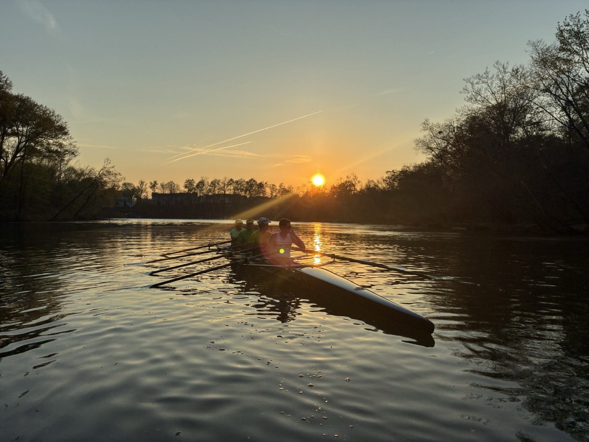
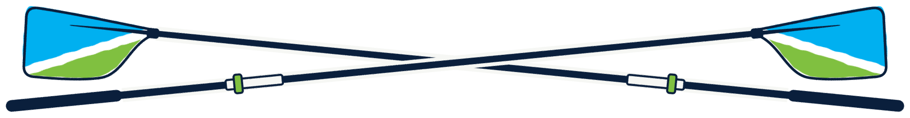
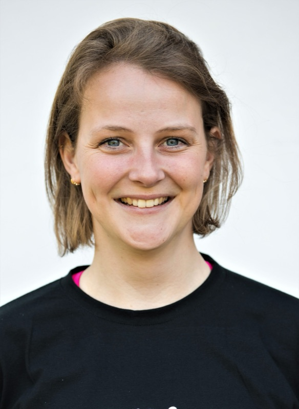
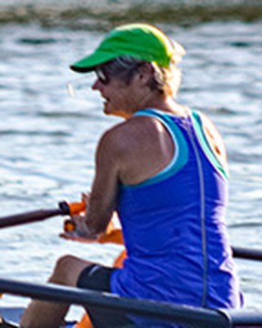
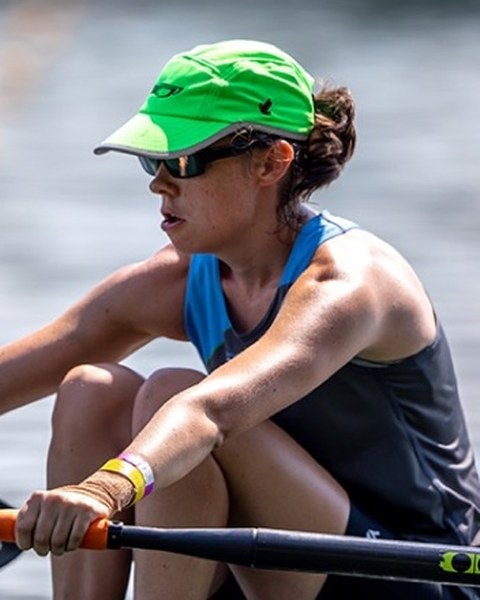
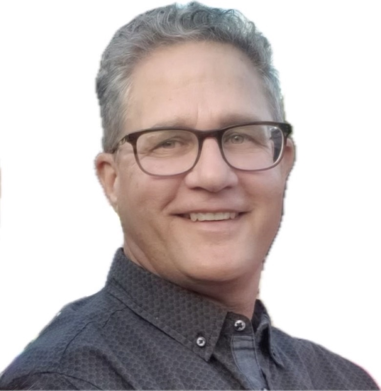
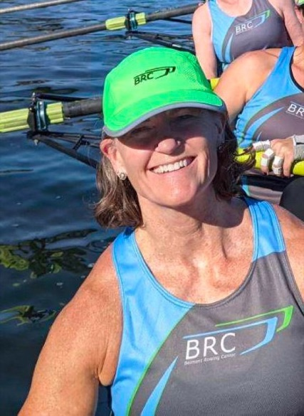
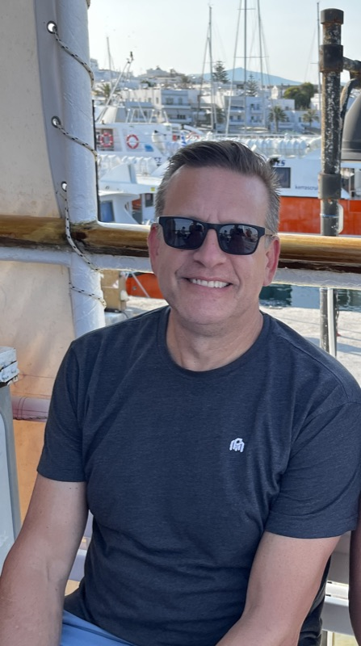
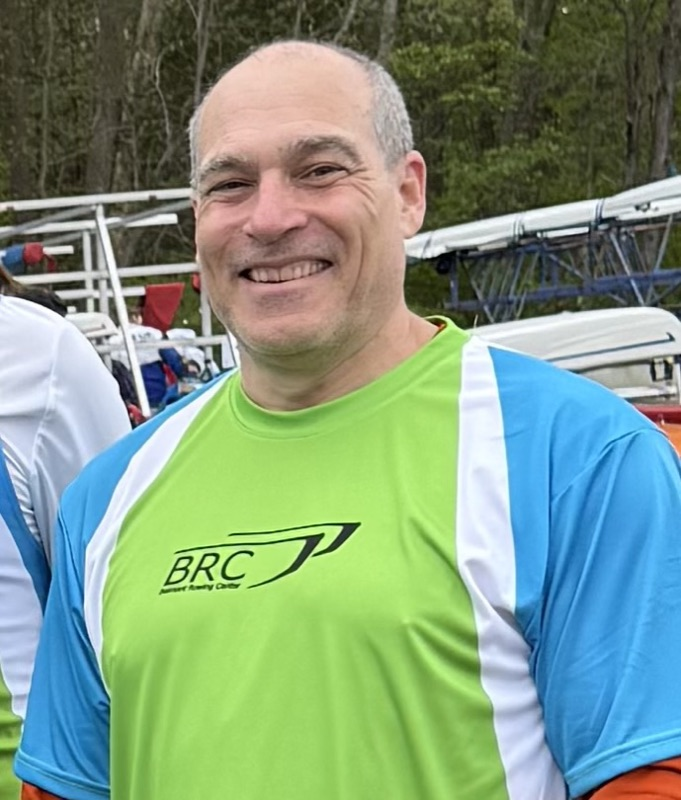

<!-- PAGE HEADER: photo with the page title over it -->
::: {.hero .hero-short}
{.bg alt="" style="object-position: center 55%"}

# ABOUT BELMONT ROWING CENTER
:::

<!-- SUB-NAVIGATION: jump links to the sections below -->
::: {.pill-nav role="navigation" aria-label="On this page"}
[COACHES](#coaches) [BOARD MEMBERS](#boardmembers) [HISTORY](#history1) [POLICIES](#policies) [LOCATION](#location) [DONATE](#donate)
:::

<!-- COACHES: the head coach as a wide card, then the other coaches two per row -->
::: {.band .band-light}
::: {.oars-row}
{alt=""}
{alt=""}
:::

## COACHES {#coaches}

Our amazing coaches are the heart of our family here at Belmont Rowing Center! They are passionate about rowing and committed to carrying out our mission to promote the growing sport of rowing through educational, competitive, and inclusive programs. We are lucky to have coaches with a wide variety of experience and expertise who are ready to help you reach your goals!

::: {.person}
{.person-photo loading="lazy" alt="Johanna Niederbroker"}

::: {.person-body}
### Johanna Niederbroker
[BRC Head Coach]{.role} [she/her]{.pronouns}

Johanna brings 20 years of competitive rowing experience and a proven track record of developing youth rowers into national-level competitors in Germany. As a certified rowing coach by the German Rowing Federation, she has coached competitive rowers across all age groups – from youth (ages 9-14) to university athletes and adult beginners. The progression from assistant children’s rowing coach to Youth Head Coach at Deutscher Ruder-Club von 1884 e.V., Hannover, Germany, and University Club Head Coach at University of Hanover demonstrates her ability to build comprehensive coaching systems – from identifying talent and structuring training, to managing success in competitions and supporting athletes through advancement.

Apart from her qualifications as a coach, she holds a M.Ed. degree in Secondary Education and a German Teaching License. Her expertise in education – combined with fluency in German and English – positions her well to communicate effectively with athletes, families, and staff, and to bring evidence-based coaching methodologies to Belmont Rowing Center.

[Coach.Johanna@belmontrowing.org](mailto:Coach.Johanna@belmontrowing.org){.email}
:::
:::

:::: {.people-grid}
::: {.person}
{.person-photo loading="lazy" alt="Kristin Sherman"}

::: {.person-body}
### Kristin Sherman
[Masters and DEVO Coach]{.role} [she/her]{.pronouns}

Kristin rowed for three years at UVA as part of their first women’s crew, rowing in a 4+ and then a lightweight 8+ at races on the East Coast, including the Head of the Charles. In 2011, after decades away from the sport, she returned to rowing with us. As a masters rower, she has competed mostly in sweep events, but has also taken up sculling and occasionally racing in her own single. Kristin has been an educator for most of her professional life, so enjoys coaching very much

[Coach.Kristin@belmontrowing.org](mailto:Coach.Kristin@belmontrowing.org){.email}
:::
:::

::: {.person}
{.person-photo loading="lazy" alt="Patricia Stichnoth"}

::: {.person-body}
### Patricia Stichnoth
[Learn to Row Coach / Private Lessons]{.role} [she/her]{.pronouns}

Patricia fell in love with the sport of rowing in 2016 when she started volunteering for the Head of the Charles regatta while living in Boston. After spending years exclusively in single sculls, she learned to row with others in 2021 and now calls the quad her favorite boat! Patricia is a product manager in tech by day, and enjoys running, hiking, and baking in her free time

[Coach.Patricia@belmontrowing.org](mailto:Coach.Patricia@belmontrowing.org){.email}
:::
:::
::::
:::

<!-- BOARD MEMBERS: the President's letter, then the board bios two per row, then name-only members -->
::: {.band .band-white}
## BOARD MEMBERS {#boardmembers}

:::: {.letter}
### A Message From the Belmont Rowing Center Board of Directors President, Dan Hartley:

::: {.lead}
I am honored to serve as your Board President. My journey from a novice rower to helping with site planning has given me a deep appreciation for the effort it takes to keep our club afloat—both literally and figuratively.
:::

Looking ahead to 2026, my focus is two-fold:

- Empowering our Youth: We are committed to building a robust youth program that fosters teamwork, resilience, and a love for the water. On a personal note, I have two granddaughters I hope to see in BRC colors in a few years, and I want to ensure the program they inherit is world-class.
- Strengthening our Masters: Whether you are a sweep rower or a sculler, whether you are a competitive row, prefer recreational rowing, or have never rowed, we will continue to invest in the equipment and coaching necessary to help our adult members reach their personal bests.
- Our new site planning remains a priority as we build a sustainable home for rowing in Belmont. This club is more than just a collection of boats; it is a community built on the water, stroke by stroke.

I look forward to seeing you all at the boathouse and on the river.

::: {.signature}
Smooth Water,

Dan Hartley
:::
::::

:::: {.people-grid}
::: {.person}
{.person-photo loading="lazy" alt="Dan Hartley"}

::: {.person-body}
### Dan Hartley
[President]{.role} [he/him]{.pronouns}

As a Charlotte native who called Belmont home starting in 2013, Dan has watched our town grow and change. But it wasn’t until he and his wife stepped into a shell during a 2017 “Learn to Row” session that he truly connected with the beauty of the Catawba. That experience changed their lives, leading them into the Masters program and eventually through the “COVID reset” that introduced many of us to the focus and discipline of sculling.  Dan has been married for 46 years to his high school sweetheart, Jenny. He has two sons and two granddaughters. A native of Charlotte, Dan currently resides in Belmont. He is a graduate of the University of North Carolina at Charlotte’s College of Architecture and has served on the Lake Wylie  Marine Commission and the Belmont Zoning board.

[President@belmontrowing.org](mailto:President@belmontrowing.org){.email}
:::
:::

::: {.person}
{.person-photo loading="lazy" alt="Debbie is happy to be rowing!"}

::: {.person-body}
### Debbie Brown
[Member-At-Large]{.role} [she/her]{.pronouns}

Debbie began rowing in 1981 with Navy Women’s Crew at the United States Naval Academy. She also has rowed with the Yarmouth Rowing Club in Yarmouth, Maine. Debbie lives in Cramerton. After moving to the Charlotte area in September of 2020, she quickly found BRC and joined in the fun of rowing (both sweep and sculling) with a great group of people. When not rowing, cycling, running, or playing golf, Debbie works as in-house counsel for a national engineering company, and is also registered in Maine as a professional engineer. Her education and experience give her the background needed to help with the planning and implementation of developing and building BRC’s new site, which will provide BRC with a dock and, eventually, a boat house.

[Programming@belmontrowing.org](mailto:Programming@belmontrowing.org){.email}
:::
:::

::: {.person}
{.person-photo loading="lazy" alt="David Yagnesak"}

::: {.person-body}
### David Yagnesak
[Vice President]{.role} [he/him]{.pronouns}

David began sculling in the sometimes-frigid tidal waters of the Long Island Sound. There he developed the basic skills and a deep love for rowing. After a move to Charlotte, he sought out BRC and joined the Masters Program where he trains and competes. His role with BRC is to develop and execute our Strategic Plan and help the club continuously improve by listening to our members, soliciting ideas and working with the rest of the Board to implement.

[Senior.VP@belmontrowing.org](mailto:senior.vp@belmontrowing.org){.email}
:::
:::

::: {.person}
{.person-photo loading="lazy" alt="Glen Danziger"}

::: {.person-body}
### Glen Danziger
[Treasurer]{.role} [he/him]{.pronouns}

Glen began rowing on the water at the Belmont Rowing Center in 2024, inspired by time spent training on a Hydrow erg during the COVID years. A lifelong water-sports enthusiast, enjoying sailing, fishing, water skiing, and swimming, Glen was naturally drawn to rowing as a way to combine fitness, community, and time on the water. As a member of the Board, Glen’s goal is to help build awareness of our club and strengthen its connection to the broader community. He sees his role much like the skeg on a shell—helping provide stability, direction, and forward momentum as we continue to grow. Glen has lived in the Charlotte area for over 25 years and works for one of the region’s major financial institutions. He is married with two grown children, and at home he is happily outnumbered by a mix of dogs, cats, and chickens.

[Treasurer@belmontrowing.org](mailto:treasurer@belmontrowing.org){.email}
:::
:::
::::

:::: {.tile-grid}
::: {.tile .person-tile}
### Clair Kettle
[Secretary]{.role}
:::

::: {.tile .person-tile}
### Toni Keating
[Parent Liaison]{.role}
:::

::: {.tile .person-tile}
### Emily Lyons
[Member-At-Large]{.role}
:::
::::
:::

<!-- HISTORY -->
::: {.band .band-light}
## HISTORY {#history1}

Established in 2013, Belmont Rowing Center offers affordable and inclusive rowing programs to youth and adults to encourage physical activity, support health and wellness, foster teamwork and promote the sport of rowing. Located on the Catawba River in Belmont, NC, BRC provides a unique recreational opportunity for individuals of all body types and abilities of teens through seniors. Though most BRC rowers live in Gaston or Mecklenburg County, BRC draws participants from the entire Charlotte metropolitan region, which has a population of 2.2 million and growing (as of 2023).

BRC program offerings have included:

:::: {.tile-grid}
::: {.tile}
### Youth

- Youth Novice
- Youth Competitive
- Youth Summer Camps
- Indoor rowing for youth
- Summer camp for underserved youth (in partnership with Behailu)
- 1 day clinic for Jack & Jill (an organization whose mission is to develop leadership skills in African American youth)
- Rowing & Robotics camp
- Adaptive rowing programs at Camp Dogwood for visually impaired youth
:::

::: {.tile}
### Adults

- Adult Learn to Row
- Adult Developmental (intermediate)
- Adult Masters Competitive Rowing
- Individually Tailored Private Lessons
- Indoor rowing for adults
- ROAR, (Rowing for Active Recovery), a program for cancer patients and survivors
- Adaptive rowing program at Camp Dogwood for visually impaired adults
:::
::::

Despite relocating twice and operating on a short-term lease, BRC has managed to grow and thrive, even with much of its energy focused on the search for a permanent home. That search culminated successtully in December 2017, when several rowers teamed up to purchase 13.6 acres of land on the Catawba River in Belmont, NC. BRC then donated approximately 3.4 acres to the City of Belmont for a municipal park, with the remainder to serve as a permanent home for BRC. This arrangement provides a significant site upgrade while providing a new waterfront park for public enjoyment
:::

<!-- POLICIES -->
::: {.band .band-white}
## POLICIES {#policies}

::: {.doc-list}
**[BRC Safety Policy](https://drive.google.com/file/d/1D4yfsQwteLG-jOoWZRWqejBiDfsj7Gzk/view?usp=share_link)**

**[BRC Weather Policy](https://drive.google.com/file/d/1eCwa2g2AicR4t2Oy4iSEPZmJbJrAMTwS/view?usp=share_link)**

**[BRC Private Boat Storage and Independent Rowing Policy](https://drive.google.com/file/d/1kbaUgsFeZPIZN3rmquECj1yPD0JuSj4d/view?usp=share_link)**
:::
:::

<!-- LOCATION: the address card beside the map (shared .location component) -->
::: {.band .band-light}
## LOCATION {#location}

:::: {.location}
::: {.address-card}
**Address:**

1500 River Drive\
Belmont, NC 28012

We launch and have parking at Riverside Marina
:::

::: {.location-map .map-embed}
<!-- Google map of the address (same map as the old site) -->
<iframe loading="lazy" src="https://maps.google.com/maps?q=1500%20river%20drive%20Belmont%2C%20nc%2028012&amp;t=m&amp;z=12&amp;output=embed&amp;iwloc=near" title="1500 river drive Belmont, nc 28012"></iframe>
:::
::::
:::

<!-- DONATE: the navy Donate band (shared .band-cta, as on the home page) -->
::: {.band .band-navy .band-cta}
## DONATE {#donate}

### Support Our Growth

Belmont Rowing Center is registered as a [501(c)(3)]{.nowrap} non-profit organization.  Contributions to the Belmont Rowing Centers are tax-deductible to the extent permitted by law.  Belmont Rowing Center tax identification number is 46-4057146

BRC is a registered 501c3 under the name\
“North Charlotte Rowing”

::: {.btn-row}
[Donate Today](https://www.zeffy.com/en-US/donation-form/support-the-growing-sport-of-rowing-at-belmont-rowing-center){.btn-brc .btn-brc-lg}
:::
:::
