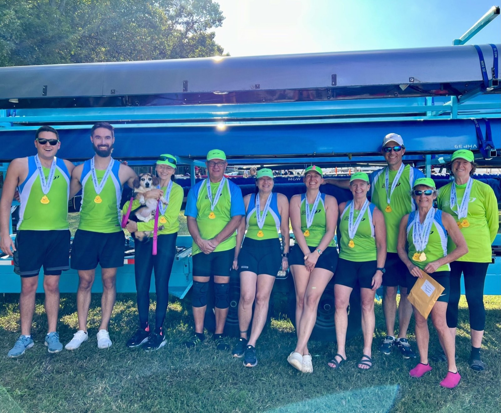

```{r}
#| include: false
source("../R/schedule.R")   # seasonal facts and tables come from schedule.xlsx
```

<!-- HERO -->
::: {.hero .hero-short}
{.bg alt="" style="object-position: center 30%"}
:::

<!-- PAGE TITLE + JUMP LINKS -->
::: {.band .band-light}
# Adult Rowing Charlotte, NC

[Belmont Rowing Center - Adult Programs]{.subheading}

::: {.pill-nav}
[MASTERS TRAINING](#masters) [MASTERS SKILLS](#devo) [LEARN TO ROW](#adultltr) [REGATTAS](#masterregattas)
:::
:::

::: {.divider}
:::

<!-- MASTERS TRAINING TEAM -->
::: {.band .band-panel .band-tight}
## MASTERS TRAINING TEAM {#masters}
:::

::: {.band .band-light}
::: {.panel}
BRC’s Masters Training Team is appropriate for current BRC Masters rowers; it may also be appropriate for rowers with significant previous experience who would like to refine their technique and increase fitness in a structured environment. This program meets `r season("masters-training", "meets")`.

To determine if you are at the appropriate level, contact us using our contact form [here](/contact/index.qmd). Rowers who have recently completed Learn To Row or whose rowing experience is limited or long ago might find our Masters ([SKILLS](#devo)) or [Learn To Row](#adultltr) programs a better fit.

**New rowers at this level are welcome to join the team at any point during the season!**

Masters Training team members can also row outside of structured practices as long as they abide by the [Independent Rowing guidelines](/other/index.qmd#independent) and requirements.

All Masters Training Team lineups (practice and racing) are determined by the Head Coach. Masters Training Team members must hold an active [USRowing membership](https://membership.usrowing.org/).
:::

::: {.centered}
### `r season("masters-training", "year")` Master Training Team - `r season("masters-training", "term")` Season

::: {.btn-row}
[Register](https://www.icrew.club/register?clubkey=1626fb75-9eb1-b24b-4202-b008f5af5980){.btn-brc}
:::
:::

The `r season("masters-training", "year")` Masters Training `r season("masters-training", "term")` Season starts on `r season("masters-training", "start")` and runs until `r season("masters-training", "end")`. The season consists of on-the-water practices (weather permitting) on `r season("masters-training", "practice_days")`. Fees are paid up-front for the season or on a monthly payment schedule through our club management system – iCrew. The fee for the `r season("masters-training", "term")` season is `r season("masters-training", "fee")`. Fee/costs for Regattas are handled separately.

```{r}
season_summary("masters-training")
```

```{r}
weekly_table("masters-training")
```
:::

::: {.divider}
:::

<!-- MASTERS SKILLS TEAM -->
::: {.band .band-panel .band-tight}
## MASTERS SKILLS TEAM {#devo}
:::

::: {.band .band-light}
::: {.panel}
Masters Skills Team is open to recent Learn To Row participants and those with limited rowing experience. It may also be a good fit for those returning to the sport after a long time away or those that want to row in less rigorous practices.  Masters Skills Team rowers can, and often do, participate in Regattas.  This program focuses on establishing a baseline of fundamental skills that are necessary for rowing independently or with a coached program. The first half of the course is spent sculling and then moves to sweep rowing for the 2^nd^ half.  This will also prepare you to pass the Level 1 Safety and Skills Review.

**New rowers at this level are welcome to join the team at any point during the season!**

**Masters Skills Team rowers are expected to leave knowing the following skills:**

- General Water Safety
- Rowing Safety
- Basic Progression of a Stroke
- Pick Drills
- Reverse Pick Drills
- Pause Drills
- General Rowing Terminology
- Steering by Pressure
- Backing Water
- Stopping a Boat
- Rowing together at moderate rates (18 – 24 spm)
:::

::: {.centered}
### `r season("masters-skills", "year")` Master Skills Team - `r season("masters-skills", "term")` Season

::: {.btn-row}
[Register](https://www.icrew.club/register?clubkey=1626fb75-9eb1-b24b-4202-b008f5af5980){.btn-brc}
:::
:::

The `r season("masters-skills", "year")` Masters Skills Team `r season("masters-skills", "term")` Season starts on `r season("masters-skills", "start")` and runs until `r season("masters-skills", "end")`. The season consists of on-the-water practices (weather permitting) on `r season("masters-skills", "practice_days")`. Fees are paid up-front for the season or on a monthly payment schedule through our club management system – iCrew. The fee for the `r season("masters-skills", "term")` season is `r season("masters-skills", "fee")`. Fee/costs for Regattas are handled separately.

```{r}
season_summary("masters-skills")
```

```{r}
weekly_table("masters-skills")
```
:::

::: {.divider}
:::

<!-- ADULT LEARN TO ROW -->
::: {.band .band-panel .band-tight}
## ADULT LEARN TO ROW {#adultltr}
:::

::::: {.band .band-light}
::: {.panel}
The Learn To Row Session is a 3-day course, starting with an evening session on-land, providing an introduction to rowing, equipment, terminology as well as learning the basic rowing stroke using a rowing machine (referred to as an ergometer or “erg”). The evening introduction is followed by Saturday and Sunday morning sessions that will be on-the-water, providing instruction on rowing safety, getting the boat (or shell) from the rack to the water, getting your oars and body into the boat, and learning to row.

Most participants have never set foot in a rowing shell before their first class. Classes are taught with the understanding that participants have never touched an oar before. Learn To Row is taught using sculling shells. Sweep rowing is taught in our Masters Skills Team program, which is the next step after completing Learn To Row.
:::

### `r season("adult-learn-to-row", "term")` `r season("adult-learn-to-row", "year")` Learn To Row Schedule

**This `r season("adult-learn-to-row", "term", case = "lower")`, we are offering `r session_count("adult-learn-to-row")` alternative Learn To Row Sessions.  Each session runs 3 days.  Choose one of the sessions in either `r season("adult-learn-to-row", "months")`.**

```{r}
session_table("adult-learn-to-row")
```

::: {.btn-row}
[Register](`r season("adult-learn-to-row", "register_link")`){.btn-brc}
:::

### There are 2 styles of rowing, Sculling and Sweep.

:::: {.tile-grid}
::: {.tile}
#### Sculling

Sculling boats are for 1, 2, or 4 rowers, and each rower has 2 oars.
:::

::: {.tile}
#### Sweep

Sweep boats have 4 or 8 rowers, where each rower has 1 oar. This is the style of rowing described in The Boys in the Boat and A Most Beautiful Thing. It is also commonly seen on motivational posters about teamwork.
:::
::::

### Expectations

Don’t worry, everyone is bad at rowing when they start. While some rowers may pick up the stroke faster than others, prepare to feel like a baby giraffe, it’s normal. We welcome masters of all ages with our current adult rowers range from their 20s to their 80s. The course focuses on rowing technique and does not consist of hard workouts. However you will be active during class. Therefore there are some requirements:

- Participants do need to certify that they can *swim. You can choose to wear a life jacket at any time although it is only required in specific situations.*
- Participants must be comfortable lifting at least 30 pounds overhead (you will have to lift boats to carry on your shoulder).
- Participants must weigh less than 230 pounds because of equipment design limitations.

Our coaches are used to working around injuries and mobility restrictions, so please let them know of any issues. Even something like a sprained ankle can create discomfort that a coach can help you work around.

Upon completion of Learn To Row, participants will need to either continue into the Masters Skills Team program or take private lessons before being ready to row on their own.

If you are interested in finding out more about Learn To Row, please contact us at info@belmontrowing.org

::: {.small}
BRC uses the iCrew team management platform to manage registrations, process payments, and obtain all required documentation. Upon your first login you will be required to create a profile before you can register for any BRC programming. Once registered and prior to your first practice you will need to e-sign the *Participation Agreement*, *Code of Conduct*  and USRowing waiver located in the “My Documents” section of your iCrew account.
:::

------------------------------------------------------------------------

### What To Bring

:::: {.tile-grid}
::: {.tile}
#### Required Gear

- Athletic clothing
  - Close-fitting
  - Bright, high-visibility
  - Moisture-wicking
  - Non-cotton, spandex
- Socks
- Water shoes or sandals
- Water bottle
:::

::: {.tile}
#### Recommended Gear

- Hat
- Sunglasses
- Sunscreen
- Extra layers or a jacket
- Spare change of clothes/socks
- Athletic sneakers/trainers
- Snacks
- Insect repellent
:::
::::
:::::

::: {.divider}
:::

<!-- MASTERS REGATTAS -->
::: {.band .band-panel .band-tight}
## `r season("masters", "regatta_season", case = "upper")` REGATTAS {#masterregattas}
:::

::: {.band .band-light}
```{r}
regatta_table("masters")
```

Above schedule are potential regattas the Masters Teams may attend, based on coach/member interest.
:::

::: {.divider}
:::
