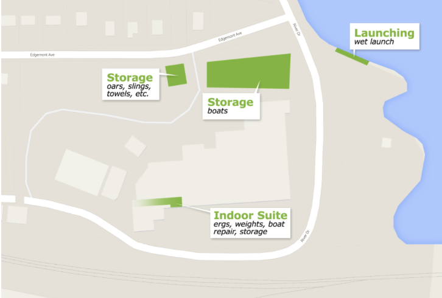

<!-- PAGE HEADER: photo of the river with the page title over it -->
::: {.hero .hero-short}
{.bg alt="" style="object-position: center 45%"}

# Contact Information
:::

<!-- LOCATION: intro, then the address cards beside the site map (shared .location) -->
::: {.band .band-white}
::: {.oars-row}
{alt=""}
{alt=""}
:::

::: {.lead}
BRC is located on the Catawba River in Belmont, NC. The site is an old mill property offering BRC use of the shoreline and river, grounds for boat storage, and indoor space for boat repair and erg training
:::

:::: {.location}
::: {.address-card}
**Physical Location:**

1500 River Drive\
Belmont, NC 28012

[Get Directions](https://www.google.com/maps/dir//35.2373424,-81.0156972/@35.2366652,-81.0164385,17.49z/data=!4m2!4m1!3e0){.btn-brc-outline}
:::

::: {.address-card .address-mailing}
**Mailing Address:**

Belmont Rowing Center\
PO Box 1401\
Belmont, NC 28012
:::

::: {.location-map .framed}
{fig-alt="Map showing the location of Belmont Rowing Center at 1500 River Drive, Belmont, NC, on the Catawba River" width="726" height="490"}
:::
::::
:::

<!-- CONTACT US: the navy CTA card (shared .cta-card) -->
::: {.band .band-light}
:::: {.cta-card}
## Contact Us

Email us at [info@belmontrowing.org](mailto:info@belmontrowing.org)

::: {.btn-row}
[Email Us](mailto:info@belmontrowing.org){.btn-brc .btn-brc-lg}
:::
::::
:::
