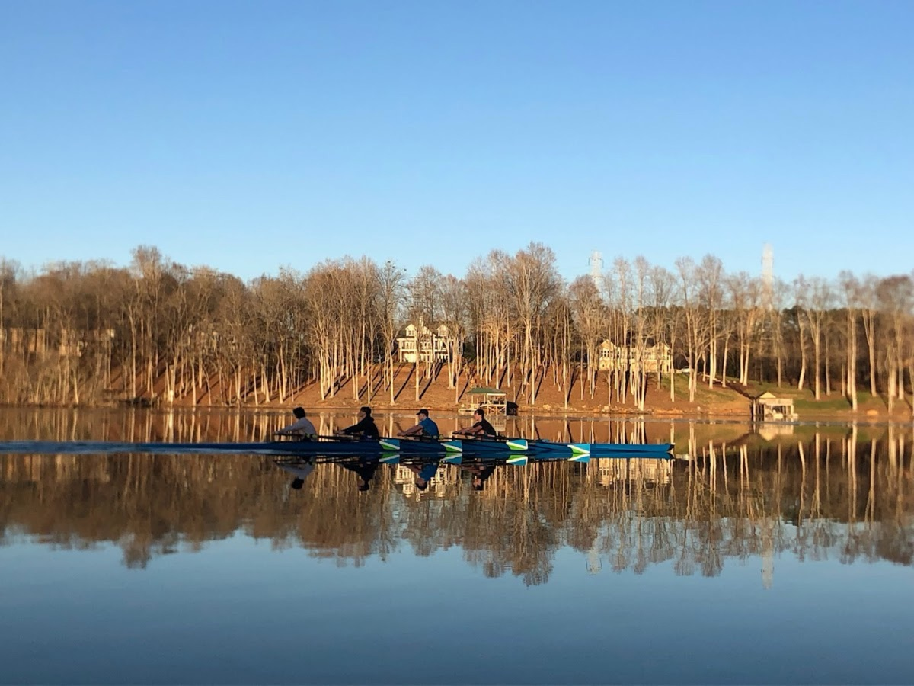
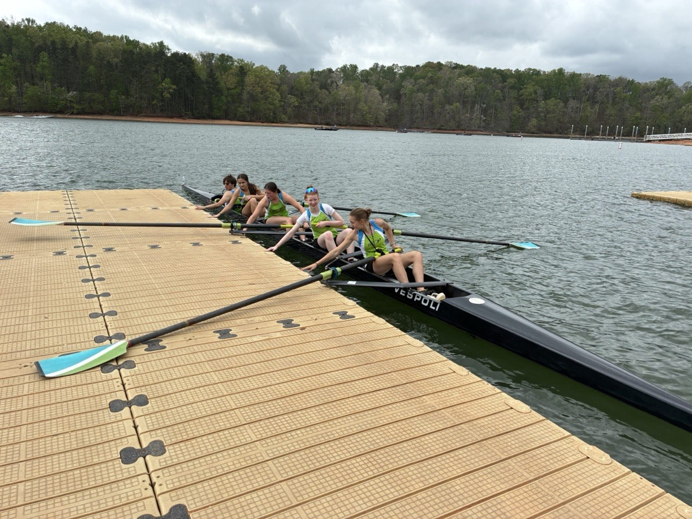
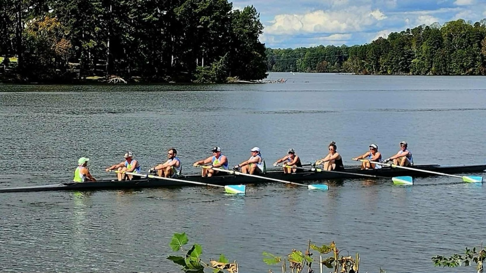

```{r}
#| include: false
source("R/schedule.R")   # seasonal facts and tables come from schedule.xlsx
```

<!-- HERO -->
::: {.hero}
{.bg alt=""}

# Row Together, Grow Together

Your Seat Is Waiting!
:::

<!-- INTRO -->
::: {.band .band-light}
::: {.centered}
## Belmont Rowing Center {.display-heading}

[LOCATED ON THE CALM WATERS OF THE CATAWBA RIVER, JUST 10 MILES WEST OF UPTOWN CHARLOTTE]{.tagline}

[Charlotte Rowing At It's Best]{.motto}
:::
:::

::: {.divider}
:::

<!-- CLUB PROGRAMMING -->
::: {.band .band-navy .band-tight}
## CLUB PROGRAMMING

::: {.btn-row}
[Register Today!](https://www.icrew.club/register?clubkey=1626fb75-9eb1-b24b-4202-b008f5af5980){.btn-brc .btn-brc-lg}
:::
:::

::: {.band .band-light}
:::: {.card-grid}

::: {.photo-card}
{.bg alt="" style="object-position: top"}

[Youth Programs](/youth/index.qmd){.btn-brc}
:::

::: {.photo-card}
{.bg alt=""}

[Adult Programs](/adult/index.qmd){.btn-brc}
:::

::: {.photo-card}
{.bg alt=""}

[Other Programs](/other/index.qmd){.btn-brc}
:::

::: {.photo-card}
{.bg alt=""}

[About Us](/about/index.qmd){.btn-brc}
:::

::::
:::

::: {.divider}
:::

<!-- UPCOMING EVENTS: from the home_events tab of schedule.xlsx -->
::: {.band .band-white}
## Upcoming Events

```{r}
home_events()
```
:::

::: {.divider}
:::

<!-- OUR CLUB -->
::: {.band .band-light}
::: {.centered}
## Our Club

**Belmont Rowing Center promotes the growing sport of rowing through educational, competitive, and inclusive programs.**

**Our mission is to offer affordable and inclusive rowing programs for youth and adults to encourage physical activity, support health and wellness, foster teamwork, and promote the sport of rowing**

**We offer a variety of rowing opportunities for youth (12+) and adults, including Summer Camps, Learn to Scull/Sweep, Indoor Rowing and Strength Training, and year-round youth and adult rowing teams. Whether you are looking for competitive rowing opportunities, want to improve your skills and fitness at a recreational pace, or have no prior experience and would like to try something new, come experience the beauty of the Catawba River and the supportive community of BRC rowers!**
:::

::: {.narrow}
## Our Core Activities

- Provide educational rowing programs and training opportunities.
- Serve youth and adults rowers.
- Attract and retain high quality coaches.
- Develop rowing and team skills and facilitate participation in competitive opportunities.
- Demonstrate inclusivity – race, size, age, and economic background.
- Support our rowers in the development of strength, endurance, improved health, injury recovery perseverance, leadership, grit, and teamwork.
:::

## Our Values

:::: {.tile-grid}

::: {.tile}
### Education

- We teach the sport of rowing to individuals having diverse skill and fitness levels – programs include Learn to Row, Development, Youth, and Masters.
- We develop skills leading to mastery and competitive opportunities.
- We enable personal and character development to achieve benefits such as teamwork, resilience, leadership, perseverance, and confidence.
:::

::: {.tile}
### Responsibility

- We are responsible for one another on the water and on land. We are committed to maintaining an effective safety program.
- We manage our finances to create sustainability and enable potential growth.
:::

::: {.tile}
### Communication

- We recognize communication is key to our success.
- Our standard: Promote and deliver professional transparent communication and invite feedback. Communication is inclusive of source, content, and form.
:::

::: {.tile}
### Community

- We are passionate about our region, our waters, and our local community.
- We desire to raise awareness of rowing throughout our region.
- We invite people from all backgrounds, economic status, and geographic areas to participate in the sport.
- We are deliberate in creating a welcoming and fun atmosphere.
- We are intentional in fostering meaningful connections among rowers.
- We serve our community through volunteering and partnerships.
:::

::: {.tile}
### Growth Mindset

- We must ask ourselves if our decisions will drive growth in value to stakeholders.
- Measurable “hard” benefits resulting from programming and events.
- Derived “soft” benefits such as perseverance, leadership skills, camaraderie, achievement of fitness goals, community relations and partnerships.
- We maintain an improvement attitude.
:::

::::
:::

::: {.divider}
:::

<!-- SUPPORT / FIND US -->
::: {.band .band-white}
::: {.centered}
## Support Our Growth

Belmont Rowing Center is registered as a 501(c)(3) non-profit organization.  Contributions to the Belmont Rowing Centers are tax-deductible to the extent permitted by law.  Belmont Rowing Center tax identification number is 46-4057146.

::: {.btn-row}
[DONATE TODAY](https://www.zeffy.com/en-US/donation-form/support-the-growing-sport-of-rowing-at-belmont-rowing-center){.btn-brc .btn-brc-lg}
:::

## Find Us

[1500 River Drive – Belmont, NC 20812](https://maps.apple.com/place?address=1500+River+Dr%2C+Belmont%2C+NC++28012%2C+United+States&coordinate=35.2364488%2C-81.0158554&name=1500+River+Dr)
:::
:::
