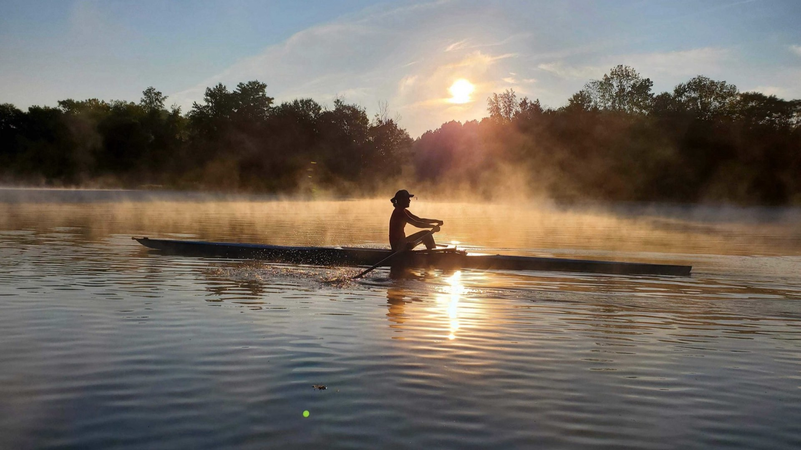
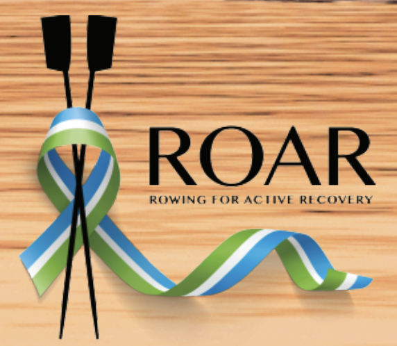

```{r}
#| include: false
source("../R/schedule.R")   # seasonal facts and tables come from schedule.xlsx
```

<!-- HERO -->
::: {.hero .hero-short}
{.bg alt=""}
:::

<!-- PAGE TITLE + JUMP LINKS -->
::: {.band .band-light}
# Other Programs

::: {.pill-nav}
[COLLEGIATE SUMMER](#collegiate) [ROWING FOR ACTIVE RECOVERY](#roar) [PRIVATE LESSONS](#private) [INDEPENDENT ROWING](#independent)
:::
:::

::: {.divider}
:::

<!-- COLLEGIATE SUMMER ROWING -->
::: {.band .band-panel .band-tight}
## COLLEGIATE SUMMER ROWING {#collegiate}
:::

::: {.band .band-light}
::: {.centered}
**For college rowers that are living in Charlotte for the summer and want to continue their training on and off the water, BRC offers summer rates for independent rowing or joining the Masters team to practice with our adult athletes.**

**Rates are set on a pro-rata basis to row from `r season("collegiate", "months")`**

### Collegiate Summer Pricing

```{r}
price_table("collegiate")
```

**BRC uses the iCrew team management platform to manage registrations, process payments, and obtain all required documentation. The link below will take you to directly to iCrew. Upon your first login you will be required to create a profile prior to registering for any BRC program.  Once registered, either select Independent Rowing or Masters Training and choose the collegiate payment options to make your payment.  Alternatively, you can choose the monthly payment option if rowing will be more or less than the full summer.  Prior to your first practice you will need to e-sign the *Participation Agreement* and *Code of Conduct* affidavits located in the “My Documents” section of your iCrew account.**

**There may be coaching opportunities during the summer months for collegiate rowers with sufficient experience to help offset the cost of the summer program.**

**Once you’ve created your iCrew account and registered, or at any time if you have questions, please contact [Info@BelmontRowing.org](mailto:Info@BelmontRowing.org) to find out more.**
:::

::: {.btn-row}
[Register Today!](https://www.icrew.club/register?clubkey=1626fb75-9eb1-b24b-4202-b008f5af5980){.btn-brc .btn-brc-lg}
:::
:::

::: {.divider}
:::

<!-- ROWING FOR ACTIVE RECOVERY (ROAR) -->
::: {.band .band-panel .band-tight}
## ROWING FOR ACTIVE RECOVERY {#roar}
:::

::: {.band .band-light}
:::: {.two-col}
::: {}
**Rowing for Active Recovery (ROAR) is a learn-to-row program for cancer patients and survivors. ROAR is delivered at no cost to participants. Both indoor rowing machine workouts as well as sessions rowing outdoors on the Catawba River will be offered. ROAR has the goal of empowering cancer patients and survivors to improve their strength, endurance, and ultimately, quality of life through rowing.**

**Rowing is a safe, low-impact sport providing a whole-body workout that can help improve physical fitness, energy levels, and self-esteem before, during, or after treatment. ROAR will meet your needs wherever you are. And while knowing how to swim is important, life jackets and flotation devices are always on hand.**
:::
::: {}
{fig-alt="ROAR: Rowing for Active Recovery logo"}
:::
::::

**ROAR FAQ**:

**Do I need prior rowing experience?:** No experience is required, we welcome people of all athletic abilities!

**Is there a cost for the program?:** Programming will be provided free of charge through the generosity of volunteers and Belmont Rowing Center.

**What are the physical requirements?:** We ask that participants are able to ambulate independently and carry up to 10lbs, total weight.

**Will I have to carry the boat?:** Participants are not required to carry boats, we will have volunteers available to assist in carrying boats down to the water.

**Do I need to attend all sessions?:** There is no commitment required, please feel free to attend as many sessions as you are able to. From prior sessions, we have found the more participants are able to attend and improve upon skills, the more enjoyable it becomes.

**What safety precautions are taken?:** We provide life jackets for all participants, to wear at their own discretion. Additionally, a safety launch will be out on the water throughout the entirety of each session.

**What should I wear?:** We recommend wearing athletic apparel, a hat, sunglasses, water shoes and sunscreen.

**What Should I Bring?:** We will provide all equipment necessary to row. In the past participants have also brought a reusable water bottle and a small backpack to bring into the boat. Of note, there is a safe place to keep personal belongings on land and we do not recommend bringing phones into the boat.

**Additional Questions?:** If you have additional questions please feel free to reach out via email at [ROAR@belmontrowing.org](mailto:ROAR@belmontrowing.org).
:::

::: {.divider}
:::

<!-- PRIVATE LESSONS -->
::: {.band .band-panel .band-tight}
## PRIVATE LESSONS {#private}
:::

::: {.band .band-light}
::: {.centered}
**Get one-on-one coaching with a private lesson. Whether you are picking up an oar for the first time or looking to get additional coaching outside of regular program practices for your race lineup, you can get the tailored coaching you need.**

**Each lesson is 90 minutes long. All rowing equipment is provided (eg: boat, oars). Please review What to Bring with you for your lesson. For most students brand new to rowing, we recommend 3-5 lessons to pick up all of the basics.**

### BRC Private Lesson Pricing

```{r}
price_table("private-lessons")
```

Pricing is for 1 rower in a sculling boat. Please contact us for multi-rower options.

---

**BRC uses the iCrew team management platform to manage registrations, process payments, and obtain all required documentation. The link below will take you to directly to iCrew. Upon your first login you will be required to create a profile prior to registering for any BRC program.  Once registered, select Private Lesson and choose the appropriate package and make your payment.  Prior to your first practice you will need to e-sign the *Participation Agreement* and *Code of Conduct* affidavits located in the “My Documents” section of your iCrew account.**

**Once you’ve created your iCrew account and registered, or at any time if you have questions, please contact [Coaching@BelmontRowing.org](mailto:Coaching@BelmontRowing.org) to find out more and set up your lesson(s) with one of our coaches.**
:::

::: {.btn-row}
[Register Today!](https://www.icrew.club/register?clubkey=1626fb75-9eb1-b24b-4202-b008f5af5980){.btn-brc .btn-brc-lg}
:::
:::

::: {.divider}
:::

<!-- INDEPENDENT ROWING -->
::: {.band .band-panel .band-tight}
## INDEPENDENT ROWING {#independent}
:::

::: {.band .band-light}
**Independent Rowing is a good option for qualified masters who want to be able to coordinate their own rowing schedule outside of a structured, coached program. Assessment and approval by the coaching staff is required for participation in this program. All pass holders must:**

- pass a flip test
- pass a swim test
- pass a tread water & don a lifejacket test
- know/abide by the river traffic pattern
- be able to solo-carry a boat to/from the water and safely launch/recover without assistance
- carry a life jacket with them in the boat
- follow all water safety requirements
- follow all COVID-19 safety protocols (eg: cleaning equipment)
- use the iCrew Boat Reservation system to note when they’re rowing

### `r season("independent", "year")` Independent Rowing Passes & Fees

If you are interested in this rowing option, please [Contact Us](/contact/index.qmd).

```{r}
price_table("independent")
```

### Equipment Use

- **BRC’s Rowing Equipment:** You must use the Boat Reservation system in iCrew to reserve a date/time for all boats you want to take out. *Note: coached programs get equipment priority.*
- **Personal/Private Equipment:** To store your equipment at BRC, you must pay an annual Private Storage Fee. Additionally, you must use the Boat Reservation system in iCrew to reserve a date/time when you want to go out and row.

### Regattas

All rowers interested in racing under BRC’s banner must hold an active Independent Rowing pass and active [USRowing membership](https://membership.usrowing.org/). Independent Rowers who want to compete in regattas under the BRC banner are responsible for:

- registering/paying for their own races and all of their equipment/athlete compliance,
- coordinating with the [Coaching Director](mailto:programming@belmontrowing.org) if they want to be included on the boat regatta trailer (in the instance that BRC is also attending the regatta), and
- coordinating with the [Coaching Director](mailto:programming@belmontrowing.org) if they want to use any BRC equipment. *Note: coached programs get equipment/race priority*.

::: {.btn-row}
[Register Today!](https://www.icrew.club/register?clubkey=1626fb75-9eb1-b24b-4202-b008f5af5980){.btn-brc .btn-brc-lg}
:::
:::

::: {.divider}
:::
