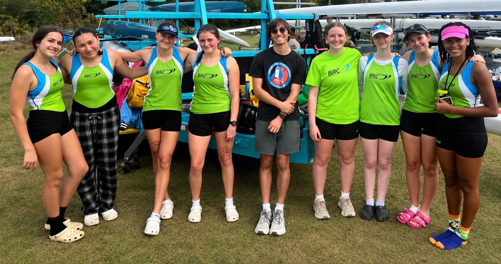

```{r}
#| include: false
source("../R/schedule.R")   # seasonal facts and tables come from schedule.xlsx
```

<!-- PAGE HEADER: photo with the page title over it -->
::: {.hero .hero-short}
{.bg alt="" style="object-position: center 10%"}

# Youth Rowing Charlotte, NC

[Belmont Rowing Center - Youth Programs]{.subheading}
:::

<!-- SUB-NAVIGATION: jump links to the sections below -->
::: {.pill-nav role="navigation" aria-label="On this page"}
[YOUTH TEAM](#youth) [SUMMER PROGRAMS](#youthLTR)
:::

<!-- YOUTH TEAM -->
::: {.band .band-light}
## YOUTH TEAM {#youth}

Our Youth Team is for middle and high school youth (starting ~12 years old) who have some rowing experience. Inexperienced rowers will join our Youth Team after completing a Learn to Row Camp. The Youth Team is a great alternative to school-based athletic programs, where you can engage in athletics, be part of a inclusive team, and develop a skill that can be leveraged in college and throughout life.  At BRC, there are no tryouts or cuts to make the team.  The more athletes we have, the more opportunities we can provide to our community.

::: {.note}
**Join our Youth Rowing Charlotte area team today or at any time during the season and become part of a vibrant community!**

Special exceptions can be requested using our [contact form](/contact/index.qmd).
:::

::: {.info-box}
### Financial Aid Available

We offer financial aid for programs based on need. These scholarships are limited by fund availability. To learn more contact us [here](/contact/index.qmd).
:::

<!-- WINTER TRAINING (open season card): facts and table from the youth-winter rows of schedule.xlsx -->
:::: {.season-card}
::: {.season-head}
### `r season("youth-winter", "year")` Youth Team - `r season("youth-winter", "term")`

::: {.btn-row}
[Register](`r season("youth-winter", "register_link")`){.btn-brc}
:::
:::

Welcome to the Youth Winter Training team for `r season("youth-winter", "months")` `r season("youth-winter", "year")`.  `r season("youth-winter", "practice_days")`

```{r}
weekly_table("youth-winter")
```
::::

<!-- FALL SEASON (completed season card: a status note instead of the Register button) -->
:::: {.season-card}
::: {.season-head}
### `r season("youth", "year")` Youth Team - `r season("youth", "term")` Season

::: {.status-note}
The season has completed. Please stay tuned for 2027 scheduling.
:::
:::

The `r season("youth", "year")` Youth `r season("youth", "term")` Season starts on `r season("youth", "start")`. For the `r season("youth", "term")`, BRC is offering programming for `r season("youth", "groups")`, with more frequent rowing days for the older and more experienced youth rowers.  The season consists of on-the-water practices (weather permitting) on `r season("youth", "practice_days")`.  There is a weekly, optional but recommended, strength training session at the Riverside Athletic Club, across from Belmont Rowing Center. Our Youth Parent Liaison(s) will help organize directly with Coach Q. Fees are paid up-front for the season or on a monthly payment schedule through our club management system – iCrew. The fee for the `r season("youth", "term")` season is `r season("youth", "fee")`.  Fee/costs for Regattas and Strength Training are handled and paid separately.

```{r}
weekly_table("youth")
```

::: {.table-note}
On race weeks, Friday’s practice is moved to Thursdays
:::
::::

### `r season("youth", "regatta_season")` Regattas

```{r}
regatta_table("youth")
```

::: {.table-note}
Above schedule are potential regattas the Youth Team may attend, based on coach/parental input
:::
:::

<!-- YOUTH SUMMER PROGRAMS (completed: status note, then the camps) -->
::: {.band .band-white}
## YOUTH SUMMER PROGRAMS {#youthLTR}

<!-- Completed season card: no heading of its own (the section heading above is its title).
     It folds up behind the status note (see CLAUDE.md, "Season card"). -->
:::::: {.season-card}
::: {.season-head}
::: {.status-note}
The season has completed. Please stay tuned for 2027 scheduling.
:::
:::

Rowing is a great team-oriented sport that is low-impact, provides a full-body workout, and teaches focus & drive. Each of our summer camps teaches the fundamentals of rowing, understanding that campers have probably never touched an oar before. Experienced members of our youth team assist the learn to row camps, mentoring new rowers. Rowers should be at least 12 years old or in 6th grade

### `r season("youth-summer", "year")` Summer Camp Offerings

<!-- CAMP CARDS: description, then the session dates and prices from schedule.xlsx -->
::::: {.tile-grid}
:::: {.tile}
#### Learn-To-Row:

For Youth age 12 and older, these sessions will focus on teaching the fundamentals of rowing techniques, boat handling, and water safety. The camp provides a safe, supportive environment where students can develop their skills, build teamwork, and enhance their physical fitness. This program not only introduces the sport, but also encourages a love for outdoor activities and nurtures a sense of accomplishment among the young athletes.

::: {.date-list}
```{r}
session_links("youth-learn-to-row", links = FALSE)
```
:::
::::

:::: {.tile}
#### Development Program:

This is a more specialized program designed to refine LTR and experienced Youth’s skills and push their limits. The camps focus on advanced rowing techniques, race strategy, and endurance training. Participants will engage in more rigorous on-water practices, complemented by strength conditioning and technical drills to enhance their overall performance. The program also includes video analysis sessions to help rowers analyze their technique and make precise adjustments. Ideal for those who have previously rowed at BRC or want to row in the fall season, these camps aim to prepare young rowes for competitive rowing, fostering both individual prowess and team cohesion (and we’ll also have fun!).

::: {.date-list}
```{r}
session_links("youth-development", links = FALSE)
```
:::
::::
:::::
::::::
:::
